# 3D Player Model from Sprites (EXPERIMENTAL)

> **EXPERIMENTAL. Work in progress, paused.** Nothing here is a finished tool or a finished asset.
> The models are rough, the scripts are research code with hard-coded paths, and the numbers in the
> notes describe an experiment, not a supported pipeline. Expect things to be broken.

This folder collects an experiment (November 2026) in rebuilding the player as a 3D model from the
game sprites of **NHL 95 PC** and **NHL 96 PC**:

- **NHL 95 PC**: a jointed template fitted to the palette-zone part labels of the 95 sprites
  (Toronto home), meshed, then coloured from the front and back control sprites. Five rounds (v1 to v5).
- **NHL 96 PC**: the 96 sprites turned out to be renders of a 3D model (one rigid pose seen from
  8 yaw angles, about 13 degrees of camera pitch). A clean low-poly Buffalo home player with one rule-based
  texture was rebuilt from them. Five rounds (clean v1 to v5), plus a first rig and pose solver.

The work was paused on 2026-11-18. See [`scripts/FINDINGS.md`](scripts/FINDINGS.md) for everything that was learned.

## Pictures

All pictures below are renders of the models. None of them show the original game sprites.

### NHL 95 PC and NHL 96 PC side by side

Each game's model turned at that game's own sprite size and camera pitch (95: about 37 px tall, about 25 degrees;
96: about 58 px tall, about 13 degrees), one sample per pixel like the games. Left is the 95 model, right the 96 model. Shown at 5x.

| At NHL 95 PC resolution | At NHL 96 PC resolution |
| --- | --- |
|  |  |
| Actual size: 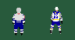 | Actual size: 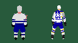 |

### NHL 96 PC (Buffalo home), latest round (clean v5)

| Hi-res | Sprite size | Actual size |
| --- | --- | --- |
| 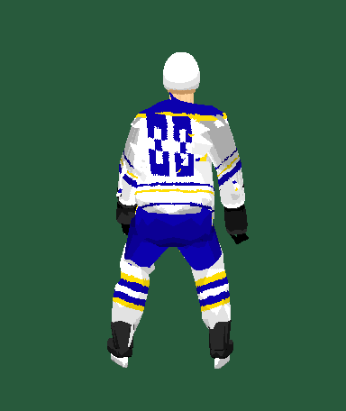 | 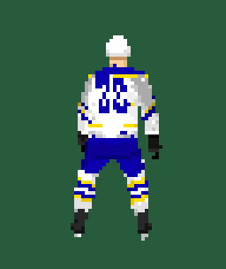 | 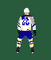 |

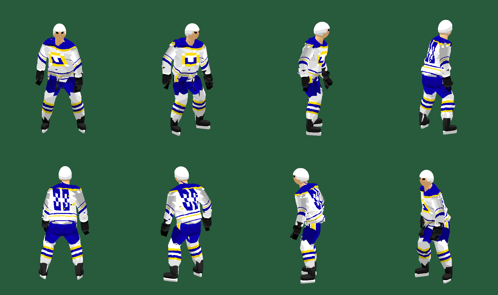

The eight game directions at sprite size:

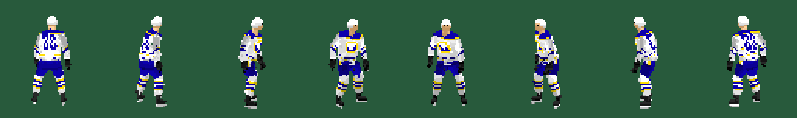

Close-ups of the modelled helmet, gloves and skates:

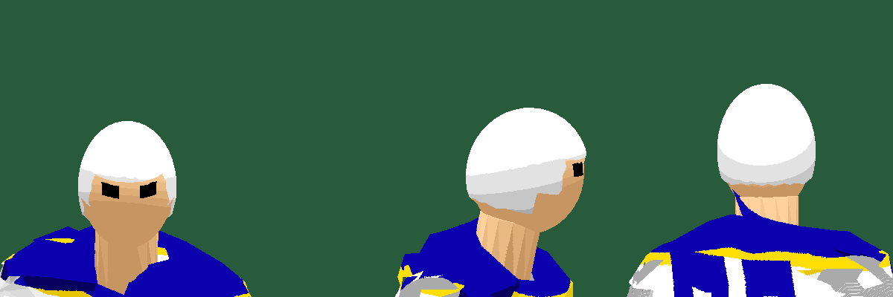
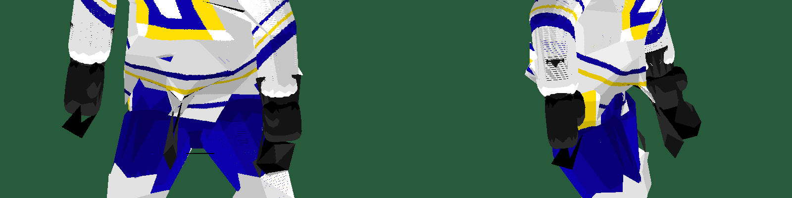
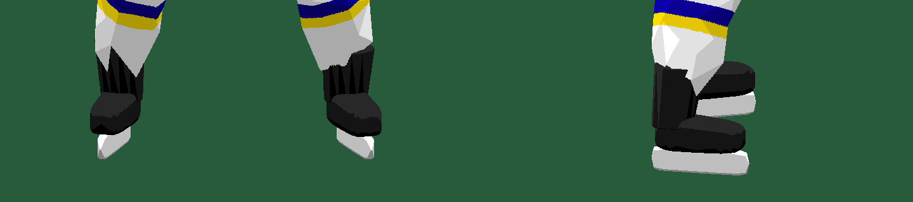

Angles the game never drew (in between its eight directions), clean v3:

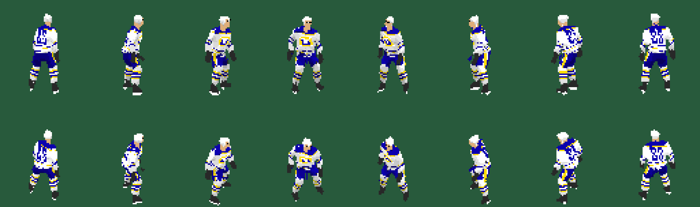

How it got there, sprite-size turntables of each round:

| Carved standing pose | Clean v1 | Clean v2 | Clean v3 | Clean v4 | Clean v5 |
| --- | --- | --- | --- | --- | --- |
| 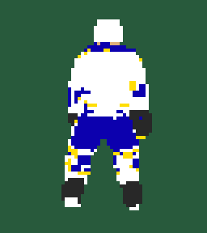 | 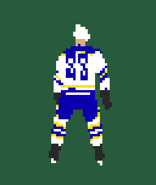 | 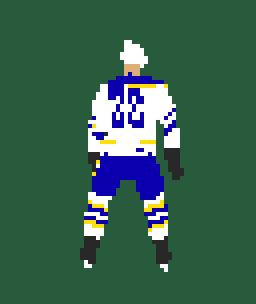 | 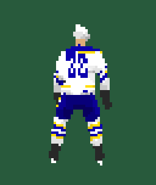 | 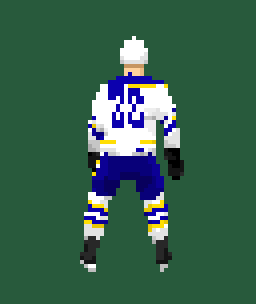 |  |

### NHL 95 PC (Toronto home), latest round (v5)

| Hi-res | Sprite size |
| --- | --- |
| 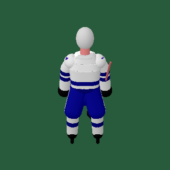 | 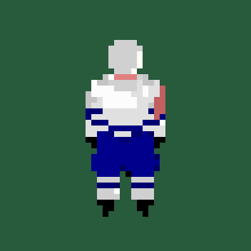 |

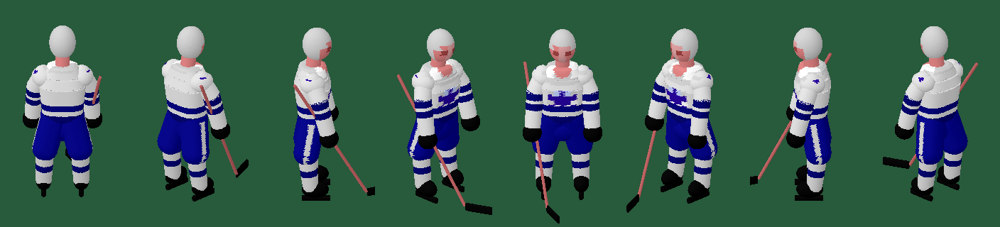

Sixteen directions at sprite size:

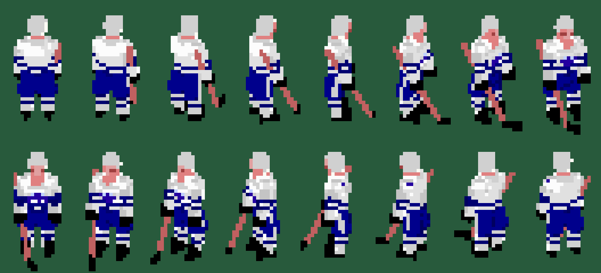

How it got there, hi-res turntables of each round:

| First model (voxels) | v2 | v3 | v4 | v5 |
| --- | --- | --- | --- | --- |
| 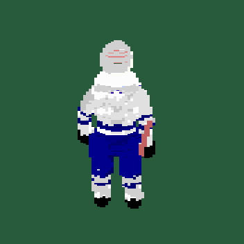 | 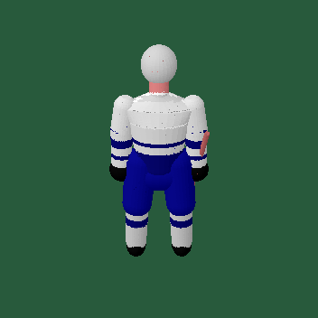 | 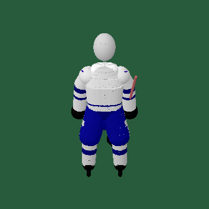 | 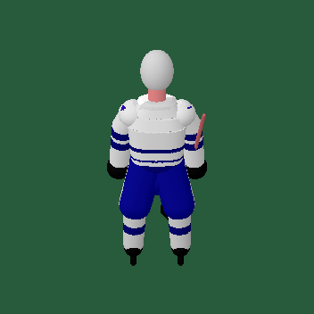 |  |

Voxels to smooth mesh (v2):

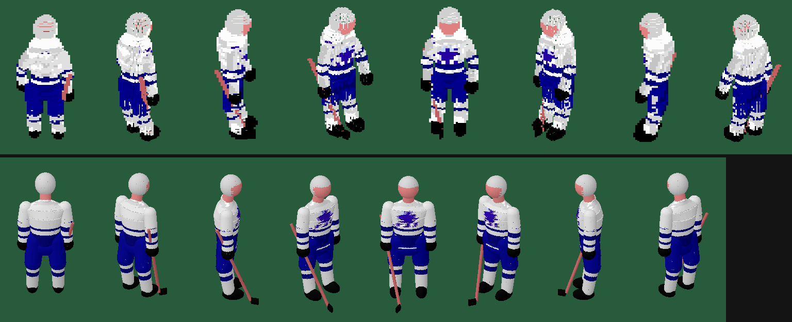

## No game data

No retail game data is in this folder. The scripts read the sprites and palettes from your own copy of
each game at run time. Pictures that put the original game sprites next to the model (the "sprite vs model"
comparisons and error maps) are left out of this public repo for that reason.

## What is here

| Folder | Contents |
| --- | --- |
| `compare_95_96/` | The final 95 and 96 models side by side as turntables, at each game's sprite size and camera pitch (`nhl95_angle_and_size` = 95 resolution, `nhl96_angle_and_size` = 96 resolution; `_1x` is actual size, the others are 5x) |
| `nhl95pc/model/` | First NHL 95 PC model: GLB, OBJ + MTL, MagicaVoxel `.vox`, fitted parameters |
| `nhl95pc/v2_mesh/` to `v5_mesh/` | Each later NHL 95 PC round: smooth mesh (GLB), voxels, parameters, turntables at sprite size and large (hi-res), 8 and 16 direction sheets |
| `nhl95pc/previews/`, `nhl95pc/progress/` | First turntables and intermediate pictures |
| `nhl95pc/wip_round4/` | State and renders from round 4 |
| `nhl96pc/clean_v1/` to `clean_v5/` | Each NHL 96 PC round: GLB, turntables at sprite size (`_1x` actual size) and large (hi-res), eight directions, angles the game never drew, close-ups (v4, v5) |
| `nhl96pc/standing_pose/` | The first carved standing-pose model and its turntables |
| `nhl96pc/progress/` | Intermediate pictures (model renders only) |
| `scripts/` | The NHL 95 PC scripts ([README](scripts/README.md)) and NHL 96 PC scripts ([README](scripts/nhl96/README.md)), plus `FINDINGS.md` |

The latest models are `nhl95pc/v5_mesh/nhl95pc_player_mesh.glb` and
`nhl96pc/clean_v5/nhl96pc_buffalo_player_clean_v5.glb`. Any glTF viewer opens them.

## Status and what is not done

- 95 PC: shape and texture are approximate; the result is not one clean texture yet.
- 96 PC standing pose: about 18% of pixels differ from the game sprites (about 5 points of that are outline pixels).
  Other poses are 39% to 46% off; the pose search is the limit, not the part sizes.
- Not done: texture for a bent torso, the chest and shins as clean shapes, the stick, a falls comparison with 95.
