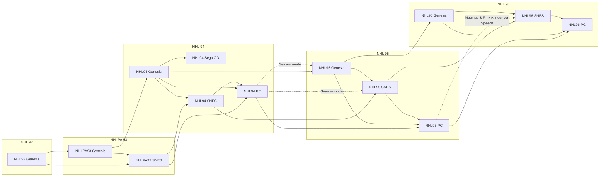

# Lineage of features and gameplay across the EA NHL games (1991-1995)

This page follows each EA NHL game from NHL Hockey (92) to NHL 96 on the Genesis, SNES and DOS. For each game it lists
what was new, what it took over and from which game, and the cross-platform links.

How to read it:

- **Box** = the back of the North American box. **Manual** = the game's manual. Page numbers are PDF pages of the scan
  listed under [Sources](#sources).
- **Code** = a routine or file in one of the public disassembly repos (linked below). Code shows that a feature is
  there. It does not always show where the feature came from.
- **Inference** marks a conclusion drawn from the sources that no source states outright.
- Names: 92G, 93G, 94G, 95G, 96G (Genesis); 93S, 94S, 95S, 96S (SNES); 94 Sega CD; 94 PC, 95 PC, 96 PC (DOS). "The
  DOS games" means 94 PC, 95 PC and 96 PC together.

Repos: [NHL92Genesis](https://github.com/abdulahmad/NHL92Genesis),
[NHLPA93Genesis](https://github.com/abdulahmad/NHLPA93Genesis), [NHLPA93SNES](https://github.com/abdulahmad/NHLPA93SNES),
[NHL94Genesis](https://github.com/abdulahmad/NHL94Genesis) (with the Sega CD notes), [NHL94SNES](https://github.com/abdulahmad/NHL94SNES),
[NHL94PC](https://github.com/abdulahmad/NHL94PC), [NHL95Genesis](https://github.com/abdulahmad/NHL95Genesis),
[NHL95SNES](https://github.com/abdulahmad/NHL95SNES), [NHL95PC](https://github.com/abdulahmad/NHL95PC),
[NHL96Genesis](https://github.com/abdulahmad/NHL96Genesis), [NHL96PC](https://github.com/abdulahmad/NHL96PC) and the
[nhl-disasm-report](https://github.com/abdulahmad/nhl-disasm-report). There is no 96S repo, so every 96S statement
here comes from its box and manual only.

## The development model

This is Abdul's reading of how the games were made. The sections below test it against the boxes, the manuals, the code
and two published interviews.

1. **The Genesis game led.** Each year's Genesis game was built on the one before it.
   - 92G and 93G: Jim Simmons (manual credits).
   - 94G, 95G and 96G: Mark Lesser (manual credits). He "rewrote and extended Simmons's code"
     (NHL95Genesis `docs/WHY_95_MOVED.md`).
2. **The SNES game spun off the Genesis game.**
   - 93S was programmed at Park Place Productions by William Robinson, with Jim Simmons as technical designer (93S
     manual credits).
   - 94S was made by EA Canada (94S manual credits: Amory Wong, Robert White, Rod Reddekopp). It started from the 93S
     code and then added the 94G features (see [94S](#94s-nhl-94-snes)).
   - The SNES game usually shipped a few months after the Genesis game (see [Release order](#release-order)).
3. **The DOS game spun off the SNES game.**
   - Source: Amory Wong, the 94S programmer, asked about the DOS releases: "He used the SNES code instead of the Genesis
     code, since I was around to answer questions" (Classic Gaming Quarterly, 2016). Wong names Robert White as the
     DOS lead; the game's own credits name Robert Penner as project leader (see [94 PC](#94-pc-nhl-hockey-dos-1993)).
   - The code agrees: 94 PC's one-timers, goalie wall animations and organ tunes are the 94S versions (see
     [1993-94](#nhl-94-1993-94)).
4. **Each year had a feature mandate across platforms.** The 94G, 94S and 94 Sega CD boxes share the same headline and
   feature list ("The siren is going to wail tonight", one-timers, penalty shots and shootout, goalie control). The 95
   boxes all lead with "This is not your ordinary cup" and a full 84-game season. The 96 boxes all lead with "the puck
   stops here" or "get ready for this" and a "New in '96" list with five-minute majors. The 96G and 96S lists also
   have an on-ice Stanley Cup ceremony.
   Each platform built most of these features with its own code (see the per-year sections).

**The interview.** The source for the DOS-from-SNES link is the Classic Gaming Quarterly interview with Amory Wong
(Chris Alaimo, February 2, 2016; link under [Sources](#sources)). Wong programmed 94S. He says the DOS programmer
"used the SNES code instead of the Genesis code, since I was around to answer questions", and was "cursing quite a bit
converting my code because of the way I optimized things".

The Hockey News oral history of NHL '94 (Sal Barry, 2018) agrees on who made which version: "EA tasks its Canadian
branch to develop NHLPA Hockey '94 for the Super Nintendo and for personal computers. One programmer takes Lesser's
code and ports it to the SNES, while other programmers work on the PC version of the game." It does not say which code
the DOS game started from. No Hockey News article that says so was found (thehockeynews.com and archive.org searched).

### Release order

Classic Gaming Quarterly notes, in a question to Wong, that 94S "came out less than 2 months after the Genesis
version". Dates are North American releases, from the Wikipedia article for each game, which cite magazines of the
time; the 94 dates also appear in the Hockey News oral history. In 1992-94 the SNES game came one to three months after
the Genesis game. In 1995 all three 96 games shipped together.

| Year | Genesis | SNES | DOS |
|---|---|---|---|
| 93 | Sep 1992 | Dec 1992 | none |
| 94 | Sep 1993 | Oct or Nov 1993 | late 1993 |
| 95 | Sep 1994 | Nov 1994 | 1994 |
| 96 | Sep 30, 1995 | Sep 30, 1995 | Sep 30, 1995 |

- 94S: the Hockey News oral history says October 1993; Wikipedia says November 1993.
- 94 PC: the Hockey News says "the fall of 1993". 95 PC: year only (the manual is "© 1994 Electronic Arts").
- 96: Wikipedia's NHL 96 article says the Genesis, SNES and DOS versions "were shipped to stores in North America on
  September 30, 1995", citing EA's press release (Business Wire).

### What the developers said

These are the development details from the Hockey News oral history and two documentaries. Tags: **THN** = the
Hockey News oral history; **Noclip ~mm:ss** = "The Making of NHL 94 - 30th Anniversary Documentary" (Noclip, 2023);
**PH ~mm:ss** = "Best Video Game of All Time! PIXELATED HEROES #nhl94" (Mikey McBryan, 2020). Times are approximate
and come from the videos' English captions. Noclip's captions are uploaded by the channel; Pixelated Heroes has only
YouTube's automatic captions, so it is paraphrased here and quoted only where the caption reads cleanly. Links are under
[Sources](#sources).

**Who built what:**

- 92G: Jim Simmons programmed it (THN). Brook: "The idea was we were going to convert the Madden model to the NHL"
  (THN); they designed it "using the same physics model that Jim had built in" football (PH ~11:18).
- 94G: Simmons moved to another project (THN); Brook: "Jim got slotted over to do to do soccer" and "I hired Mark to
  do NHL 94" (PH ~12:07). Lesser on Simmons's code: "So he just dumped the code on me" (Noclip ~20:07). He chose to
  "use the code and just tear out sections" rather than rewrite it, and over the next several versions he tore out
  "more and more" (Noclip ~20:27-20:40). That supports the arrows 93G -> 94G -> 95G -> 96G.
- 94G took "about a four or five month development cycle" (Lesser, PH ~41:31). Wong finished 94S "in less than 6
  months" (Classic Gaming Quarterly).
- 94S and 94 PC: "EA tasks its Canadian branch to develop NHLPA Hockey '94 for the Super Nintendo and for personal
  computers. One programmer takes Lesser's code and ports it to the SNES, while other programmers work on the PC
  version of the game" (THN).
- Genesis first: Brook says the SNES versions "initially, they were ports of our Genesis version", and "I would always
  do the initial design for the Genesis and then convert it"; the CD version "was almost like an afterthought"
  (Noclip ~46:59-47:18). He is speaking about EA's sports games in general, starting with Madden.
- Each platform had its own lead: an EA staffer of that era recalls that the team's notes went to "a lead on each
  product, whether it was the Genesis or Super Nintendo", who would "champion the best ideas" (Noclip ~33:47-33:56).
- 95: Brook "left EA after NHL '94 and was the developer of NHL '95", and "The creative direction really changed with
  NHL '95" (THN; also Noclip ~51:56). Lesser says the 95 game was made faster than 94 (THN). Wong was "not involved
  in NHL '95 for the SNES" (THN). Brook: "Development of the game eventually went to EA Canada" (THN).

**Features and decisions:**

- The 94 requirements, as Lesser lists them: goalie control, "four player, four user mode", crowd animations, one
  timers, "flip passes, season mode, shootout mode" and visual changes, plus reverse instant replay (Noclip
  ~21:21-21:47). Season mode is on that list, but no 94 console game shipped one; 94 PC did (see
  [the Season mode arrows](#95g-nhl-95-genesis)).
- One-timers were Lesser's 94G breakthrough: "Suddenly, I pulled a one-timer, and it was perfect" (THN); he tuned them
  late at night in the barn (PH ~41:31); "One-timers were a mess" until weeks of tuning (Noclip ~36:50).
- Fighting was fully built and improved for "NHLPA Hockey '94", then removed in a last-minute deal with the NHL, which
  owned the game footage EA wanted for the Sega CD; the game was renamed NHL '94 (THN; Noclip ~12:54-13:18). Fighting
  came back in 96 (THN; "until '96", Noclip ~13:33).
- No skating referees on the early Genesis games: "there's no refs in the game" because it "would impact the frame
  rate" (Brook, Noclip ~10:51; also THN). The 94 PC box, by contrast, shows "Refs on the ice".
- Ron Barr was brought in for the EA Sports Network branding on NHLPA 93, giving pre-game scouting reports (THN).
- 95's headline features: "trading between teams, the ability to create players and the much-anticipated full-season
  mode" (THN).
- 94 PC: "Like the Sega CD version, the PC version includes full-motion video and Barr's voice" (THN). The 94 PC box
  shows Ron Barr at the sports desk, but no video clips were found in its box text or code, so the feature table still
  lists video clips from 95 PC (see the notes under the tables).

## Diagram (Abdul's interpretation)

This is Abdul's lineage diagram, redrawn. Solid arrows: a game built on another. Dotted arrows with a label: one
feature carried across platforms.

## NHL Hockey (92), 1991

### 92G: NHL Hockey (Genesis)

- **Credits (manual):** developed by the Park Place Production Team; programmer Jim Simmons; producer Michael Brook.
- **Box:**
  - "all 22 NHL teams and 2 All-Star teams", each skater "modeled on 14 different attributes"
  - body checks, penalties ("if the ref sees you!")
  - instant replay, scouting reports, crowd reactions
  - 1 or 2 players, cooperative or competitive
- **Manual:**
  - playoffs, continued with a password (p.8, p.35)
  - fighting as a 5-minute penalty, with a "Fights Won" stat (p.19 and the stats pages)
- **Code:** the root of every later Genesis repo. 93G, 94G and 95G names trace back to 92G (NHLPA93Genesis
  `docs/conventions.md`, "Naming lineage"). The pregame scouting report is `ScoutingReport` in hockey.asm (NHL94PC
  `docs/CONSOLE_LINEAGE.md`).

## NHLPA Hockey 93, 1992

### 93G: NHLPA Hockey 93 (Genesis)

- **Credits (manual):** programmer, and music and sound, Jim Simmons.
- **New, from the manual's list "added to NHL Hockey to create NHLPA Hockey '93" (p.4-5):**
  - NHLPA rosters from the 1992 season, with Ottawa and Tampa Bay
  - goalies that dive and lunge
  - saved player stats in 8 categories
  - hooks and checks from behind
  - "flipping body check and blood on the ice"
  - saved team lines
  - player injuries
  - Pro Set stars of the game
  - organ music that reacts to the game
  - home-ice advantage tied to the crowd
  - EASN pregame scouting report, and coverage hosted by Ron Barr
  - scoring and penalty summaries
  - a new fatigue and line-change system
  - no password for the playoffs
  - EASN crowd meter
  - a slap shot that can shatter the glass
  - instant replay that follows any player
  - "new strategic fighting system"
  - hat-trick announcements
- **Box:** "Over 20 new features in '93", led by "Battery Back Up ... no passwords!", "Edit lines feature ... save them
  to battery", goalie saves and injuries.
- **Inherited:** from 92G, the engine and the design. 92G is the naming root for 93G.
- **Lost:** the NHL licence. Teams are city names only (NHLPA93Genesis `docs/conventions.md`).

### 93S: NHLPA Hockey 93 (SNES)

- **Credits (manual):** programmer William Robinson (Park Place Productions); technical design Jim Simmons.
- **Box:** the same headline and goalie-save panel as 93G, with "Hot hockey action" in place of "Over 20 new features".
  The box does not list battery back-up or saved lines.
- **Manual:** playoffs continue by password, not battery (p.21, "Saving the playoff tree").
- **Code:** the port "began as a port of NHL92 Genesis (likely while NHLPA93 Genesis was in development), then added
  what NHLPA93 needed". Some screens, such as the scoreboard layout, follow 92G rather than 93G (NHLPA93SNES `README.md`,
  `docs/history/discovery93snes.md`).

**Same or different, 93S vs 93G:**

| Item | 93S vs 93G | Source |
|---|---|---|
| Rosters, rating count | Same | Box |
| Goalie dives, injuries | Same | Box |
| Playoff save | Different (password) | Manual |
| Saved lines on battery | Different (not listed) | Box |
| Scoreboard layout | Different (92G style) | Code |

These rows support both arrows into 93S (from 92G and from 93G).

## NHL 94, 1993-94

### 94G: NHL '94 (Genesis)

- **Credits (manual):** programmer Mark Lesser.
- **New, from the manual's list "added to NHLPA Hockey '93 to create NHL Hockey '94" (p.5):**
  - goalie control; shootout game; penalty shots
  - bench and board checks
  - 3 or 4 players with the adapter
  - 1992-93 NHL rosters
  - hot and cold streaks
  - saved player records, standings and records
  - one-timers, flip passes, reverse-angle replay
  - clearing the zone on the penalty kill
  - automatic line changes
  - tougher defence and goalies, and computer shooter scoring moves
  - player and team cards, with 144 player pictures
  - local organ music (72 pieces), team logos at centre ice, new crowd animations
  - **"No fighting or blood"**
  - period stats and more game stats
  - Anaheim and Florida
- **Box:** "Over 25 new features in Hockey '94", led by 4 Way Play, goalie control, penalty shots and shootout,
  one-timers and battery back-up ("records for you and 6 friends").
- **Code:** the manual-to-code map is NHL94Genesis `docs/MANUAL_FEATURES.md`. For example:
  - one-timers: `OneTimerPass` / `OneTimerTarget`
  - shootout: `ShootoutShooters`
  - penalty shots: `PenShotChk`
  - 4 Way Play: `Detect4WayPlay`
  - per-team organ songs: `TeamSongs`
  - fighting: `checkfight` is left as a bare `rts`.
- **Inherited:** the 93G engine, via the 94 -> 93 -> 92 naming lineage.
- **Gained:** the full NHL licence (team names and logos) on top of the NHLPA licence.

### 94 Sega CD: NHL '94 (Sega CD)

- **Credits (manual):** "By EA Canada and High Score Productions"; programmer Mark Lesser; Sega CD programming by Paul
  Halmshaw, Pete Veys and Jim Sproul.
- **Box:** "Same great NHL '94 Genesis features": 4 Way Play, goalie control, penalty shots and shootout, one-timers,
  Ducks and Panthers. New on the disc:
  - over 100 video clips
  - digitized speech by Ron Barr
  - CD sound effects
  - "real organ music" (the San Jose Sharks organ)
- **Code:** "the Sega CD plays the same game". Three small code changes touch play, and the rosters drop 31 players
  (NHL94Genesis `docs/segacd_differences.md`).
- **Inherited:** all of it from 94G (code). The arrow 94G -> 94 Sega CD is confirmed.

### 94S: NHL '94 (SNES)

- **Credits (manual):** programming by Amory Wong, Robert White and Rod Reddekopp; organ music by Dieter Ruehle; music
  by Michael J. Sokyrka.
- **Box:** "Over 25 new features in Hockey '94", the same list as 94G except:
  - "5-Player support" (Hudson Soft's Super Multitap) in place of 4 Way Play
  - "new player art and animations"
  - "harder hitting defenders" (cross checks and board checks)
  - no battery line
- **Manual:**
  - Shootout and "New Playoffs" (p.5)
  - goalie control on X (p.3)
  - one-timers (p.3)
  - playoffs continued by password (p.5)
- **Lineage:** 94S started from the 93S code and then added the 94G features. The arrows 93S -> 94S and 94G -> 94S
  are both supported.
- **Code** (nhl-disasm-report `docs/ALIGNMENT.md`, appendix A1):
  - From 93S: game logic matches 93S routines instruction by instruction. 808 names come from 93S and 306 from 94G.
  - From 94G: "Shootout, player cards, line editor, crowd meter, three stars, matchups, scouting rewrite."
- **Timing:** 94S came out one to two months after 94G (see [Release order](#release-order)). That fits a port that
  waited on the 94G features (inference).
- **Wong remembers it differently.** "We started with the '93 code and Michael [Brook] gave us the '94 feature
  requirements", but Brook did not like how 93S played, "so we worked off the '93 Genesis code" (Classic Gaming
  Quarterly). The Hockey News also says one programmer "takes Lesser's code and ports it to the SNES", and Brook says
  the SNES versions were initially "ports of our Genesis version" (Noclip ~46:59). The code match with 93S points the
  other way, so this page follows the code.

### 94 PC: NHL Hockey (DOS, 1993)

- **Release:** shipped as "NHL Hockey", not "NHL '94" (NHL94PC `docs/CONSOLE_LINEAGE.md`, "Music and packaging").
- **Credits** (English manual p.21; the in-game credits in NHL94PC `src/data/far/credits.asm` list the same names):
  - original game concept: Jim Simmons, Scott Orr, Richard Hilleman
  - PC version game design: Dave Warfield, Richard Hilleman
  - project leader: Robert Penner
  - programming: Robert Penner, Victoria Wong, Eric Pauker; additional programming: Pete Veys, Dan Gessel
  - speech programming: Iain Macanulty
  - organ music: Dieter Ruehle and Michael J. Sokyrka
  - special thanks: Robert White, Ron Barr and Bruce Jamieson, among others
- **Box:**
  - "real NHL teams and logos"
  - "simulate the actual 1993 NHL season or create a league of your own with up to 24 human participants"
  - "digitized speech and over 70 pieces of digitized organ music"
  - "end-of-season awards including the Hart, Norris and Ross trophies"
  - instant replay that saves highlights to a personal reel
  - "refs on the ice"
  - one-timers
  - one or two players
- **Manual (English):**
  - one-timers (p.7)
  - the Announcer's Booth pause screen (p.8)
  - league play "with up to twenty four human players" (p.13)
  - a league manager with player trades between human-controlled teams (p.15)
  - saved league and playoff highlights (p.10)
- **Code:** NHL94PC `docs/CONSOLE_LINEAGE.md` sums it up as "a 93-generation engine carrying 94 content and the headline
  94 gameplay changes".

**Same or different, 94 PC vs the consoles:**

| Item | 94 PC vs consoles | Code says |
|---|---|---|
| Skating, shooting | Same as 93G | 93G formulas |
| One-timers | Same as 94S | 94S design |
| Goalie wall animations | Same as 94S | Not in 94G |
| Organ tunes | Same as 94S | 50 of 53 exact |
| Fighting | Same as 94 (none) | Removed |
| Penalty shots, shootout | Different (none) | Not found |
| 3+ players, manual goalie | Different (none) | Not found |
| League, awards, referee | 94 PC only | `new_league.asm` |

- **Why this supports Abdul's arrows** (code):
  - 93S -> 94 PC: the 93-generation engine.
  - 94S -> 94 PC: one-timers, wall animations and organ tunes match 94S.
  - 94G -> 94 PC: the 94 feature set and content.
- **Who led it.** The English manual (p.21) and the in-game credits both name Robert Penner as project leader and
  first programmer. Robert White appears only under special thanks; he is a credited 94S programmer. Wong remembers
  White as the DOS lead. This page follows the credits.

## NHL 95, 1994

### 95G: NHL 95 (Genesis)

- **Credits (manual):** programmer Mark Lesser.
- **New, from the manual's list "new in NHL '95" (p.2):**
  - 1993-94 rosters
  - season play, with erasable seasons
  - practice mode
  - player creation and player trades
  - league leaders
  - drop passes, fake shots, block shots
- **Box ("All new in '95"):**
  - a full 84-game season mode, with the Hart, Ross and Vezina trophies
  - trade players ("run a trade through the G.M.") or create them
  - "fake shots, drop passes, defenders 'laying down on D'"
  - faster gameplay
  - new player animations
  - a 2-on-2 "Jam" play mode
- **Code:** the manual-to-code map is NHL95Genesis `docs/MANUAL_FEATURES.md` (`SeasonMain`, `CreatePlayer`,
  `ExecuteTrade`, `dopass`, `CanBlock`). NHL95Genesis `docs/FILE_ORIGINS.md` traces every 95 file to its 94G source.
  The season, trade, create, awards and schedule files are new in 95. Lesser re-filed the 94 code into subsystem files
  (NHL95Genesis `docs/WHY_95_MOVED.md`).
- **Inherited:** 94G's engine (code), so 94G -> 95G is confirmed.
- **The "Season mode" arrows from 94 PC:** season mode first appeared on 94 PC and showed up on the 95 console
  versions. 94 PC had a full season with end-of-season awards (box; code: `AwardNamePtrs`, NHL94PC). The 95G and 95S
  boxes call season mode and its awards "all new in '95".
  - **Abdul's interpretation:** these arrows are shared design more than shared code.
  - Code evidence, which fits that reading: 95G's season, trade and awards code has no 94G source (NHL95Genesis
    `docs/FILE_ORIGINS.md`), and the DOS season, trade, create-player and awards screens "share strings and labels
    with 95G but not code" (NHL95PC `docs/CONSOLE_LINEAGE.md`). The details differ too: 94 PC and 95 PC have the same
    10 awards, including the Calder and an "EA Sports Cup"; 95G has 9, with the Pearson and no Calder. 95G trades
    allow three players a side with roster checks and a general manager; the DOS trades are one for one between human
    teams.
  - Documentary evidence, which also fits: Lesser lists "season mode" among the features EA wanted for 94 (Noclip
    ~21:38). So it was on the 94 feature list before any game shipped it, and 94 PC was the first to ship it.
  - No source says code was shared between the DOS and console season modes.

### 95S: NHL 95 (SNES)

- **Credits (manual):** design by Kevin Hogan and Michael Brook; programmers Jason Andersen and Jonah Stich. The art
  team is shared with 95G (NHL95Genesis `docs/WHY_95_MOVED.md`).
- **New, from the manual's list "new in NHL '95" (p.2):**
  - 1993-94 rosters
  - season play, practice mode
  - player creation, league leaders, player trades
  - accumulated team and player stats
  - battery backup (94S used passwords)
- **Box:** "All new in '95": a full 84-game season with awards, trades and created players, faster gameplay, new
  animations. Unlike 95G, the box has **no** fake shots, drop passes, laying down on D or 2-on-2 mode.
- **Code:**
  - The 95S repo calls it "a separate code base, related to NHL95Genesis ... and NHL94SNES" (NHL95SNES `README.md`).
  - 95S keeps 94S's whole multitap code, switched off by two changed values, so it ships 1-2 players (NHL95PC
    `docs/CONSOLE_LINEAGE.md`, "95S multitap").
  - That 94S code still inside 95S supports the arrow 94S -> 95S.

**Same or different, 95S vs 95G:**

| Item | 95S vs 95G | Source |
|---|---|---|
| Season, trades, create | Same | Manual, box |
| Practice mode | Same | Manual, code |
| Fake shot | Different (none) | Manual, code |
| Drop pass | Different (none) | Code |
| 3+ players | Different (off) | Code |
| Shootout | Same (in code) | Code |

The shootout row is unsettled. NHL95SNES `docs/MANUAL_FEATURES.md` finds shootout code (`ShootoutWonBy`) that the manual
does not mention. NHL95Genesis `docs/WHY_95_MOVED.md` says 95S has "no shootout". The two repo docs should be
reconciled.

### 95 PC: NHL Hockey '95 (DOS CD-ROM)

- **Credits** (manual p.33; the credit pages in the code, NHL95PC `src/data/front/scoreboard_data.asm`, agree):
  - lead programmer Lance Wall
  - programmers Victoria Wong, Robert Penner, Kurt Kennett
  - audio programmers Alan Stewart, Iain Macanulty
  - producer and design Ken Sayler
  - a Sportsdesk announcer (Michael Donovan) and a rink announcer (Bruce Jamieson)
- **Box:**
  - "New player moves include fake shots, drop passes, and players laying down on 'D'"
  - "New in '95": penalty shots
  - new checking and goalie animations
  - "New G.M. mode lets you trade and create players"
  - unlimited trades, signing rookies, starting line-ups, the 84-game season
  - updated rosters with the Mighty Ducks and Panthers
  - high-resolution screens and "digital quality sound effects and music"
- **Manual:**
  - a "Digitized Speech" game setting (p.7)
  - fake shot (p.9) and shot block (p.10)
  - penalty shots "when a player is on a breakaway ... and an opponent brings him down from behind" (p.14)
  - league play "with up to 26 human players" (p.17)
  - the League Manager, with trades only "between human-controlled teams", as in 94 PC (p.20)
  - no shootout, practice mode or goalie control section was found in the manual's text
- **Code:** "95 PC is built on the 94 PC engine, not ported from 95 Genesis" (NHL95PC `docs/CONSOLE_LINEAGE.md`, "What
  this means").
  - From the 94 consoles: board, bench and cross-checks, penalty shots, and a goalie poke check like 94S's.
  - From 95G: the 1993-94 season data, and 95G-style fake shots, shot blocks and roster tools, each in 95 PC's own code.
  - Its own: a contextual drop pass (no button), a fake one-timer, four shot-block animations, a goalie knee hold,
    more penalties, CD video, high resolution and digitized music.
  - Not taken: shootout, manual goalie, more than two players, practice mode.
- **Arrows:**
  - 94 PC -> 95 PC: confirmed by the code.
  - 95G -> 95 PC: features and data, not code.
  - 95S -> 95 PC: no direct evidence found. The goalie poke check is like 94S and 95S, but that is inferred from the
    animation's purpose.

## NHL 96, 1995

### 96G: NHL 96 (Genesis)

- **Credits (manual):** programming Mark Lesser.
- **New, from the manual's list "New Features for 96" (p.4):**
  - skill levels Rookie, Pro and All-Star
  - a fighting option
  - one-timer pass, give-and-go, Spin-o-Rama
  - new graphics and animations
  - advanced goalie and defence AI
  - multiple injuries
- **Box ("New in '96"):**
  - smarter skaters (break to the slot, cover for a defenceman out of position)
  - tougher goalies
  - five-minute majors (with four-minute double minors)
  - new moves
  - new sound and music ("Get Ready for This")
  - an on-ice Stanley Cup ceremony
- **Code** (NHL96Genesis `docs/MANUAL_FEATURES.md`):
  - fighting: `EngageFight`, `SetFightingMajors`
  - Spin-o-Rama: `dospinorama`
  - short-handed role routines
  - role reassignment every second: `SetRoles`
  - new goalie saves: `goaliesave`
- **Inherited:** 95G's engine (95G -> 96G). The drop pass is still 95G's button move (NHL96PC
  `docs/CONSOLE_LINEAGE.md`, "Drop pass").

### 96S: NHL 96 (SNES)

- **Credits (manual):** made by Tiburon Entertainment, "founded by veteran Super NES programmers who have been
  responsible for ... NHL Hockey '95"; "NHL 96 was programmed by Jason Andersen". Andersen is also a credited
  95S programmer, which supports the arrow 95S -> 96S (credits; inference for the code).
- **New, from the manual's list "New Features for 96" (p.4):**
  - skill levels Novice, Intermediate and Expert
  - a fighting option
  - drop passes, fake shots, Spin-o-Rama, quick stop
  - lying down on D to block shots
  - crowd chants and organ tunes, and **vocal referees**
  - advanced goalie and defence AI
  - multiple injuries
  - practice mode is kept (p.5)
- **Box ("New in '96"):**
  - give and go, drop passes, quick stops, fake shots, Spin-o-Rama
  - smarter defences, tougher goalies
  - "chanting crowds, **public address announcers** and the rocking anthem 'Get Ready for This'"
  - five-minute majors
  - an on-ice Stanley Cup ceremony
  - 1-2 players
- **Code:** none public.

**Same or different, 96S vs 96G** (box and manual only):

| Item | 96S vs 96G | Source |
|---|---|---|
| Fighting option | Same | Manual |
| Spin-o-Rama | Same | Manual, box |
| Skill level names | Different | Manual |
| Fake shot, drop pass | Same (both list) | Manual, box |
| Practice mode | Different (96S only) | Manual |
| Referee and PA voices | Different (96S only) | Manual, box |
| Players | Different (1-2 vs 1-4) | Box |

- **The "Matchup & Rink Announcer Speech" arrow from 95 PC:** the rink announcer speech starts at 94 PC, carries
  into 95 PC, then 96S (Abdul). The sources along that path:
  - 94 PC: the box lists "digitized speech" and "digitized voices"; the manual credits speech programming to Iain
    Macanulty and thanks Bruce Jamieson (p.21); the code has 61 announcer routines (`Pa` / `Say`).
  - 95 PC: a "Digitized Speech" setting (manual p.7), and Bruce Jamieson credited as rink announcer (manual p.33).
  - 96S: of the 96 console games, only 96S lists "vocal referees" (manual) and "public address announcers" (box). The
    96G manual's sound line has crowd chants and organ tunes only.
  - 96 PC has it too: speech is "the digitized voices of the announcer and the ref" (manual p.14), and "the announcer
    introduces tonight's matchup" before the scouting report (manual p.21).
  - There is no 96S code, so the link to 96S rests on its box and manual.

### 96 PC: NHL 96 (DOS CD-ROM)

- **Credits (manual):** developed by "Pioneer Productions, part of the EA Canada studio" (p.2). Programmers: Victoria
  Wong, Lance Wall, Kurt Kennett, D. Funky Swadling, Jay MacDonald, Eric Pauker, Spencer Cathey; producer and
  designer Ken Sayler (p.39). Wong, Wall, Kennett and Sayler are the core of the 95 PC team.
- **Box ("New in '96"):**
  - power-play offence, penalty-killing defence
  - goalie control
  - five-minute majors (with four-minute double minors)
  - CD-quality sound and music with "authentic organ music" and "Get Ready for This"
  - player portraits and video profiles
  - "eleven freewheeling camera angles"
  - Gravis GrIP 4-player adaptor support
- **Manual ("NHL 96 Features", p.2):**
  - exhibition, season and playoff modes
  - "two-computer modem connection for Exhibition games"
  - "up to four human-controlled players in any game"
  - "Rookie and All-Star levels of competition" (the code also has a third level, Pro: NHL96PC `docs/FEATURES.md`)
  - give and go, one-timer shots and passes
  - a fighting option
  - player creation and trades between any teams (p.18-19)
  - announcer and referee speech (p.14), with a matchup introduction (p.21)
- **Code** (NHL96PC `docs/CONSOLE_LINEAGE.md`): built on 95 PC (`README.md`, "Lineage"). It takes the 96 mandate with
  its own code:
  - three skill levels
  - manual goalie control
  - four control slots
  - fighting, whose routines "follow the NHLPA 93 Genesis ones"
  - penalty-kill and covering-D AI
  - a new goalie positioning layer
  - players skating the Stanley Cup on the ice
  - modem play, which is 96 PC only
- **Missing on 96 PC** (code): Spin-o-Rama, shootout mode, timeouts and trade rejection, which 96G has. Kept from
  95 PC: the contextual drop pass, the fake shot and fake one-timer, and four shot-block animations.
- **Arrows:**
  - 95 PC -> 96 PC: confirmed by the code.
  - 96G -> 96 PC: features, built with different code.
  - 96S -> 96 PC: not checked, because there is no 96S code.

## Feature table

Each table gives the first game with a feature and where it appears later. "Box", "Manual" and "Code" are the evidence
for the first game. "Not on" lists games where the code or the manual shows the feature is missing. A game left out was
not checked.

**Modes and saving:**

| Feature | First | Later | Not on |
|---|---|---|---|
| Playoff password | 92G | 93S, 94S | 93G (battery) |
| Battery save | 93G (box) | 94G, 95G, 95S | 93S, 94S |
| Shootout mode | 94G, 94S | Sega CD, 95G, 96G | DOS games, 96S |
| League season, awards | 94 PC (box) | 95 PC, 95G, 95S, 96 | 94 consoles |
| Trades | 94 PC (manual) | 95G, 95S, 95 PC, 96 | 94 consoles |
| Create player | 95G, 95S | 95 PC (box), 96 | 94 PC |
| Practice 2-on-2 | 95G, 95S | 96S (manual) | 95 PC |
| Skill levels | 96G, 96S | 96 PC | 95 PC |
| Modem play | 96 PC | none | consoles |

**Players and control:**

| Feature | First | Later | Not on |
|---|---|---|---|
| 3-4 players | 94G (box) | Sega CD, 95G, 96G, 96 PC | 94 PC, 95 PC |
| 5 players | 94S (box) | none (95S off) | 95S |
| Manual goalie | 94G, 94S | Sega CD, 95G, 95S, 96 | 94 PC, 95 PC |
| One-timers | 94G (box) | all later games | 93 games |
| Spin-o-Rama | 96G, 96S | none | 96 PC |

**Moves, rules and AI:**

| Feature | First | Later | Not on |
|---|---|---|---|
| Fighting | 92G, 93G | 93S; back in 96 | 94, 95 games |
| Board, bench checks | 94G, 94S | 95G, 95S, 95 PC | 94 PC |
| Penalty shots | 94G, 94S | Sega CD, 95 games, 96 | 94 PC |
| Hot, cold streaks | 94G, 94S | Sega CD | 94 PC |
| Fake shot | 95G | 95 PC, 96 | 95S |
| Drop pass | 95G (button) | 95 PC (own), 96 | 95S |
| Shot block, lay down | 95G, 95 PC | 96G, 96S, 96 PC | 94 PC |
| Five-minute majors | 96 (all 3 boxes) | none | none |
| PK, covering-D AI | 96G, 96 PC | 96S (box) | 95 PC |

**Presentation:**

| Feature | First | Later | Not on |
|---|---|---|---|
| Ron Barr coverage | 93G (manual) | 93S, Sega CD, 94 PC | none |
| Per-team organ music | 94G (72 tunes) | 94S (53), 94 PC | 93 games |
| Referee on the ice | 94 PC (code, box) | 95 PC | consoles |
| Video clips | Sega CD (box) | 95 PC, 96 PC | consoles |
| Rink announcer speech | 94 PC | 95 PC, 96S, 96 PC | none found |
| On-ice Cup ceremony | 96G, 96S (box) | 96 PC (code) | none |

Notes on the tables:

- "96" alone means all three 96 games; "95 games" means 95G, 95S and 95 PC.
- 96S's play modes are exhibition, season and practice (manual p.5), so the shootout mode is listed as missing there.
- The 94 PC Stanley Cup animations (`SPAgetcup`) are older than the 96 ceremony. The 96 PC version adds players
  skating the Cup on the ice (code).
- Rink announcer speech: 94 PC box ("digitized speech") and manual credits (speech programming); 95 PC manual
  (speech setting, rink announcer); 96S box and manual; 96 PC manual. The Sega CD's Ron Barr is a voiced scouting
  report (NHL94Genesis `docs/segacd_differences.md`), counted under "Ron Barr coverage", not here.
- Video clips: the Hockey News says 94 PC "includes full-motion video" like the Sega CD. Its box lists none and none
  was found in the NHL94PC code, so 94 PC is not listed; treat that row as open.

## What the evidence says about Abdul's diagram

- **Genesis-led, confirmed.** Every Genesis game builds on the one before it (code), and the Genesis manuals list each
  year's new features against the previous Genesis game.
- **SNES from Genesis, confirmed with a twist.** 93S started from 92G code, then took 93G's features (code). 94S
  started from the 93S code and added the 94G features (code: 808 names from 93S, 306 from 94G). The SNES games
  shipped one to three months after the Genesis games in 1992-94, and with them in 1995. 95S is a separate code base by another team that
  still carries 94S code. 96S was made by Tiburon, whose founders made 95S (manual).
- **DOS from SNES, confirmed for 94 PC.** Wong's interview (Classic Gaming Quarterly, 2016) and the code agree:
  one-timers, goalie wall animations and organ tunes come from 94S. 95 PC and 96 PC then build on the DOS engine, not on a console port, and add each year's
  console features in their own code.
- **Yearly mandate, confirmed.** The boxes in each year share most feature lines and, apart from 94 PC ("The
  ultimate hat trick", with the same "Any Goalie, NHL" quote as the other 94 boxes), their headline. Each
  platform implemented the features separately: drop pass, fake shot, penalty shots, skill levels, fighting and PK AI each
  differ in code between platforms.
- **Cross-platform arrows.** Season mode first appeared on 94 PC and showed up on the 95 console versions. In
  Abdul's interpretation that is shared design more than shared code, and the code comparison and Lesser's 94
  feature list (Noclip ~21:38) fit that. Rink
  announcer speech starts at 94 PC, carries into 95 PC, then 96S; 96S's box and manual are the only 96 console
  sources to mention announcer or referee voices. 96 PC's manual also has the announcer introduce the matchup.

## Sources

**Interviews and documentaries:**

- Classic Gaming Quarterly, "Amory Wong: The Classic Gaming Quarterly Interview", Chris Alaimo, February 2, 2016:
  http://www.cgquarterly.com/2016/02/02/amory-wong-the-classic-gaming-quarterly-interview/
  Source for the DOS game using the SNES code, and for Wong's account of how 94S was made.
- The Hockey News, "The Making of NHL '94: An Oral History", Sal Barry, October 7, 2018:
  https://thehockeynews.com/news/all-access/the-making-of-nhl-94-an-oral-history
  Source for who built which version, the fighting decision, Ron Barr, Brook leaving after 94, and the 94 release
  months ("THN" above).
- Noclip, "The Making of NHL 94 - 30th Anniversary Documentary", November 24, 2023:
  https://www.youtube.com/watch?v=NRFT3iQx1BY
  Interviews with Michael Brook (shown on screen as "Designer") and Mark Lesser, and EA staff. Cited from the
  channel's English captions ("Noclip ~mm:ss" above).
- Mikey McBryan, "Best Video Game of All Time! PIXELATED HEROES #nhl94", October 11, 2020:
  https://www.youtube.com/watch?v=FWqNi7Al1RI
  Fan documentary with Brook and Lesser. Cited from YouTube's automatic captions ("PH ~mm:ss" above).

**Release dates:** Wikipedia's articles
[NHLPA Hockey '93](https://en.wikipedia.org/wiki/NHLPA_Hockey_%2793), [NHL '94](https://en.wikipedia.org/wiki/NHL_%2794),
[NHL 95](https://en.wikipedia.org/wiki/NHL_95) and [NHL 96](https://en.wikipedia.org/wiki/NHL_96), which cite
Electronic Gaming Monthly, GamePro, Nintendo's SNES release list and EA's September 30, 1995 press release.

**DOS game scans:** [EA Sports NHL 94-97 PC: Box, Manual & Pack-in Scans](https://archive.org/details/ea-nhl94-nhl95-nhl96-nhl97-ibm-pc-dos-win-scans)
on the Internet Archive ([PC] below). It has the US box, English manual and reference card for 94 PC, and the box and
manual for 95 PC and 96 PC.

**Box backs** (North American boxes; [GDB] = gamesdatabase.org, [LB] = LaunchBox Games Database):

| Game | Box back |
|---|---|
| 92G | [LB](https://images.launchbox-app.com/6ea9b15c-8f23-4f25-920a-3c3487be412d.jpg) |
| 93G | [GDB](https://www.gamesdatabase.org/Media/SYSTEM/Sega_Genesis/BoxBack/big/Nhlpa_Hockey_93_-_1992_-_Electronic_Arts.jpg) |
| 93S | [GDB](https://www.gamesdatabase.org/Media/SYSTEM/Nintendo_SNES/BoxBack/big/Nhlpa_Hockey_93_-_1992_-_Electronic_Arts.jpg) |
| 94G | [LB](https://images.launchbox-app.com/fcc00a99-bf30-48ed-950a-87212142ed11.jpg) |
| 94 Sega CD | [LB](https://images.launchbox-app.com/c23350df-8cca-415e-bdf8-0db9531fd7fc.jpg) |
| 94S | [LB](https://images.launchbox-app.com/227c9bfb-7beb-4085-b116-70f07e210569.jpg) |
| 94 PC | [LB](https://images.launchbox-app.com/cafd40fb-4e5f-4c26-9ad2-a5795a2bf216.jpg), [PC: back leaflet](https://archive.org/download/ea-nhl94-nhl95-nhl96-nhl97-ibm-pc-dos-win-scans/NHL94-PC/US/NHL94-PC_US_01_Back_Leaflet.png) |
| 95G | [GDB](https://www.gamesdatabase.org/Media/SYSTEM/Sega_Genesis/BoxBack/big/Nhl_95_-_1994_-_Electronic_Arts.jpg) |
| 95S | [GDB](https://www.gamesdatabase.org/Media/SYSTEM/Nintendo_SNES/BoxBack/big/Nhl_95_-_1994_-_Electronic_Arts.jpg) |
| 95 PC | [PC](https://archive.org/download/ea-nhl94-nhl95-nhl96-nhl97-ibm-pc-dos-win-scans/NHL95-PC/NHL95-PC_01_Box_Back.png), [LB](https://images.launchbox-app.com/708f73ba-79f4-4194-bbf3-e27a7faa4536.jpg) |
| 96G | [GDB](https://www.gamesdatabase.org/Media/SYSTEM/Sega_Genesis/BoxBack/big/Nhl_96_-_Electronic_Arts.jpg) |
| 96S | [GDB](https://www.gamesdatabase.org/Media/SYSTEM/Nintendo_SNES/BoxBack/big/Nhl_96_-_1995_-_EA_SPORTS.jpg) |
| 96 PC | [PC](https://archive.org/download/ea-nhl94-nhl95-nhl96-nhl97-ibm-pc-dos-win-scans/NHL96-PC/NHL96-PC_01_Box_Back.png), [GDB](https://www.gamesdatabase.org/Media/SYSTEM/Microsoft_DOS/BoxBack/big/NHL_96_-_1995_-_EA_SPORTS.jpg) |

**Manuals.** [Gen] is the Internet Archive collection
[SEGAGenesisMegaDriveManuals](https://archive.org/details/SEGAGenesisMegaDriveManuals) and [SNES] is
[SNESManuals](https://archive.org/details/SNESManuals):

| Game | Manual |
|---|---|
| 92G | [Gen: NHL Hockey (USA)](https://archive.org/download/SEGAGenesisMegaDriveManuals/NHL%20Hockey%20%28USA%29.pdf) |
| 93G | [nhl94.com scan](https://nhl94.com/multimedia/manuals/NHLPA93_GEN.pdf) |
| 93S | [SNES: NHLPA Hockey '93](https://archive.org/download/SNESManuals/NHLPA%20Hockey%20%2793%20%28USA%29.pdf) |
| 94G | [Gen: NHL '94](https://archive.org/download/SEGAGenesisMegaDriveManuals/NHL%20%2794%20%28USA%2C%20Europe%29.pdf) |
| 94 Sega CD | [SEGA CD Manuals: NHL '94](https://archive.org/details/SEGACDManuals) |
| 94S | [SNES: NHL '94](https://archive.org/download/SNESManuals/NHL%20%2794%20%28USA%29.pdf) |
| 94 PC | [PC: US manual](https://archive.org/download/ea-nhl94-nhl95-nhl96-nhl97-ibm-pc-dos-win-scans/NHL94-PC/US/NHL94-PC_US_03_Manual.pdf); German: [Handbuch](https://archive.org/details/nhl-hockey-handbuch) |
| 95G | [Gen: NHL 95](https://archive.org/download/SEGAGenesisMegaDriveManuals/NHL%2095%20%28USA%2C%20Europe%29.pdf) |
| 95S | [SNES: NHL '95](https://archive.org/download/SNESManuals/NHL%20%2795%20%28USA%29.pdf) |
| 95 PC | [PC: manual](https://archive.org/download/ea-nhl94-nhl95-nhl96-nhl97-ibm-pc-dos-win-scans/NHL95-PC/NHL95-PC_02_Manual.pdf) |
| 96G | [Gen: NHL 96](https://archive.org/download/SEGAGenesisMegaDriveManuals/NHL%2096%20%28USA%2C%20Europe%29.pdf) |
| 96S | [SNES: NHL '96](https://archive.org/download/SNESManuals/NHL%20%2796%20%28USA%29.pdf) |
| 96 PC | [PC: manual](https://archive.org/download/ea-nhl94-nhl95-nhl96-nhl97-ibm-pc-dos-win-scans/NHL96-PC/NHL96-PC_03_Manual.pdf) |

