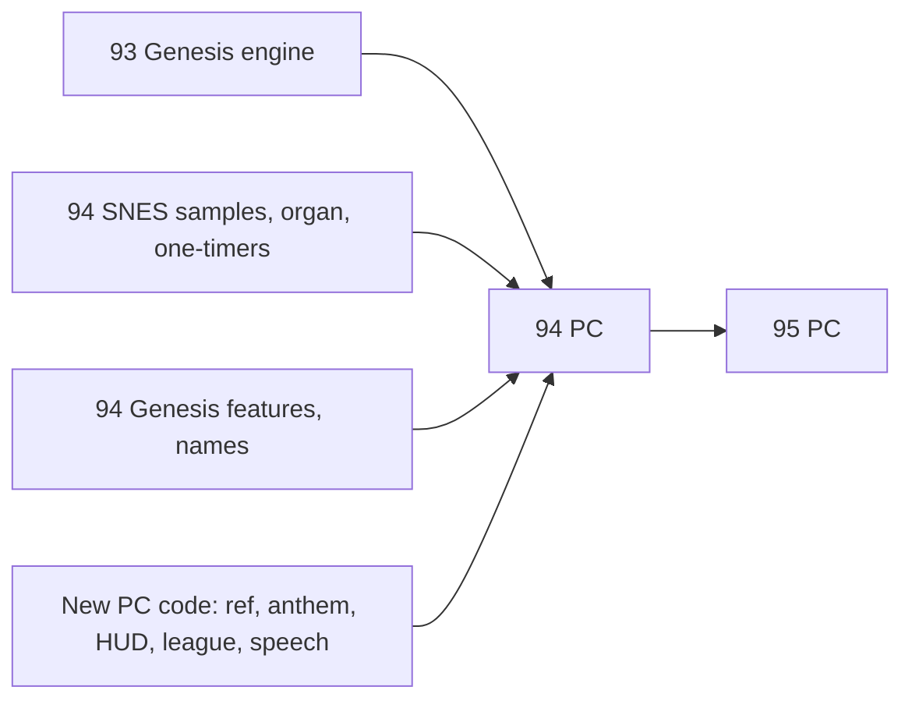

# From the consoles to 94 PC: how the code changed

How EA turned the 93 and 94 console code into NHL Hockey for DOS (94 PC), and what 95 PC kept. It covers each
feature the PC port added or changed, the routines that do it, and the console code they replaced.

**Sources.** Every routine name and path is from these public repos:

- [NHL94PC](https://github.com/abdulahmad/NHL94PC): disassembly of `HOCKEY.EXE` and its 20 overlays.
- [NHL95PC](https://github.com/abdulahmad/NHL95PC): disassembly and C decompilation.
- [NHLPA93Genesis](https://github.com/abdulahmad/NHLPA93Genesis) (93G),
  [NHL94Genesis](https://github.com/abdulahmad/NHL94Genesis) (94G),
  [NHLPA93SNES](https://github.com/abdulahmad/NHLPA93SNES) (93S) and
  [NHL94SNES](https://github.com/abdulahmad/NHL94SNES) (94S).

The sound comparisons decoded the sound data of my own copies of each game. No game data is in this page.

**Tags:**

- **Code**: read in the routine named.
- **Data**: a table, string or data file shows it, but the logic wasn't traced.
- **Measured**: worked out on decoded audio (the method is given).
- **Inference**: my reading. Not proven.

Routine names in the PC repos were given by the people who disassembled them. They match a console name when the
routine does the same job. So a shared name is evidence of matching code, not of EA's own names. Written 2026-11-26.

## Contents

- [Short answer](#short-answer)
- [Where the code came from](#where-the-code-came-from)
- [The platform layer](#the-platform-layer)
- [Game speed and acceleration](#game-speed-and-acceleration)
- [Rink size and coordinates](#rink-size-and-coordinates)
- [Player attributes](#player-attributes)
- [Lines and line changes](#lines-and-line-changes)
- [Referee](#referee)
- [Anthem and pre-game](#anthem-and-pre-game)
- [Between plays](#between-plays)
- [Scoreboard](#scoreboard)
- [Music](#music)
- [Sound effects: what plays when](#sound-effects-what-plays-when)
- [Crowd noise](#crowd-noise)
- [Announcer speech](#announcer-speech)
- [Digital samples: formats and matches](#digital-samples-formats-and-matches)
- [Other changes](#other-changes)
- [What 95 PC carried forward](#what-95-pc-carried-forward)
- [Not verified](#not-verified)

## Short answer

- **Gameplay** is the 93 Genesis engine. Its physics constants and goalie save roll are 93G's, with speeds and
  distances rescaled once for a wider, shorter rink. None of the 94G or 94S physics changes are in it (Code).
- **Content and features** come from 94: the 94 rosters, one-timers and goalie wall animations as in 94S, and the
  per-team organ tunes. 50 of the 53 organ tunes match 94S note for note (Code, Data).
- **New on 94 PC:**
  - a referee on the ice
  - an anthem and pre-game ceremony
  - three stars
  - big-screen animations between plays
  - a permanent bottom scoreboard panel
  - four forward lines
  - a 0-15 Faceoffs rating
  - coach modes
  - a two-line pass option
  - play-by-play speech
  - a league mode
  - FMV

  All of these are new code; none is console code (Code).
- **Sound** was rebuilt on EA's PC sound library. Effects are programs on a MIDI-style sound bank, and crowd noise is
  two looped samples whose volume follows a crowd level.
- **Samples:** 15 of the 30 Sound Blaster effect timbres are the same recordings as 94 SNES samples. They have the same
  11,025 Hz sample spacing and the same length to within one BRR block (Measured). None match the Genesis samples.
  None of the speech matches any console sample.

## Where the code came from

**Lineage.** The 94 PC engine keeps the 93 Genesis formulas. 94 features were added on top as new PC code. 95 PC is the
94 PC engine again, retuned, with more 94/95 features (NHL95PC `README.md`, NHL94PC and NHL95PC
`docs/CONSOLE_LINEAGE.md`). NHL94PC's README names 93S and 94G as its bases. In the physics, though, the 93G constants
are the ones 94 PC matches, not the 93S ones (see the next sections).

**Shared names.** I counted routine labels in NHL94PC `src/engine` that share a name with a label in the console
repos.

| Repo | Shared names |
|---|---|
| 93G | 161 |
| 94G | 162 |
| 93S | 156 |
| 94S | 150 |

Of the 296 engine routines, 163 share a name with 93G or 94G. 132 share no name with any console repo. Those 132 are
the PC additions: the referee, the HUD panel, the line builder, the intro, the game log and the coach modes (Code,
label count).

The repo's name history (`docs/name_map.csv`) lists the source of each name: 3,658 new names, 745 from 95 PC, 238
Microsoft C runtime, 137 94G, 27 RTLink and 16 93G (Data).

## The platform layer

**Platform.** The consoles run on a 68000 (Genesis) or 65816 (SNES), with sound on a Z80 or SPC700. 94 PC is a
16-bit real-mode DOS program. It's built with Microsoft C, uses the large memory model and is linked by RTLink/Plus
with 20 overlays (NHL94PC `README.md`). 95 PC is a 32-bit Watcom C program on DOS/4GW (NHL95PC `README.md`).

| Part | 94 PC routine or file |
|---|---|
| Overlays | `AI`, `GAME`, `INIT`, `LP`, `MENUS`, `MOVIE`, `STATS`, `FADES*` `.OVL` |
| Overlay calls | thunks such as `DoGameFrameThunk` |
| Timer | `HookInt8`, pc/system.asm |
| Video | src/pc/video (planar VGA) |
| Input | src/pc/input, `joyq_*` |
| Save | `SaveGameState` / `LoadGameState` |
| Sound | src/pc/sound, EA BGP drivers |

- **Overlays:** most game routines are reached through RTLink thunks that load the overlay and then jump. For example,
  `DoGameFrameThunk` loads `AI.OVL` (src/lib/rtlink). The consoles have no overlays (Code).
- **Timer:** `HookInt8` reprograms the PC timer with divisor 2E9Ch, so it runs at about 100 Hz. `CalibrateRetrace` times
  the VGA retrace for frame pacing (pc/video/retrace.asm) (Code).
- **Video:**
  - Drawing is to planar VGA canvases with dirty rectangles per page (pc/video). The consoles use VDP sprites and
    tile planes (Code).
  - The shapes are in EA's `.QPP` / `.PPV` packed formats (NHL94PC `docs/PPV_FORMAT.md`).
- **Input:**
  - keyboard, joystick and mouse, through a queue (`joyq_peek`, `joyq_pop`, `joyq_flush`) that `RunGameFrames` drains
  - hot keys (`HandleHotKey`), such as F1-F8 for lines

  The consoles read joypads (Code).
- **Saving:**
  - League and roster databases (`TEAMS.DB`, `KEY.DB`, `ATT.DB`), a saved game in progress (pc/game_saveload.asm,
    `INIT.OVL`) and a floppy export (pc/floppy_export.asm, `LP.OVL`).
  - 93G and 94G use battery saves. 93S and 94S use passwords (Code, Data).

## Game speed and acceleration

**Tick rate.** All the games run 24 game steps per game second.

- The consoles scale movement by `d7`, the frames since the last step.
- 94 PC has no `d7`. `RunGameFrames` (front/game_main.asm) runs the pending ticks. Each one calls `ClockTick`, which
  counts 18h steps per clock second (engine/hockey.asm), and `DoGameFrame`, which runs one game frame (Code, NHL94PC
  `docs/CONSOLE_LINEAGE.md`).

**Converting the values.** The constants were not converted per platform. They are the 93G constants, and only the
ones that depend on rink size were rescaled:

| Value | 93G | 94 PC |
|---|---|---|
| Friction | >>6 / >>9 | Same |
| Stop (`stopna`) | 150 | Same |
| Accel factor | 32 − wt/8 + agil | Same |
| Speed index | (energy×speed)>>12 | Same |
| Gravity | 96 | Same |
| Push (`dirtab`) | 200 (141) | 175 (124) |
| Top speed² | (n+20)×275 | 4800+220n−n² |
| Shot vector | $44 | 3Bh |
| Shot factor | $5249 | Same |

- `dirtab` and the shot vector are cut by about 0.87, which is the end-board ratio (264 / 298 ≈ 0.886). The top-speed
  table became a new curve, 4800 to 7875 (Code, `playeracc` in engine/skate.asm, `doshot` and `checkwallcoll` in
  engine/physics.asm).
- 94G's halved ratings, crowd speed boost, ×17 position step and carrier half-acceleration are not in 94 PC. Nor are
  the 93S/94S SNES friction table and stop rule (Code).

## Rink size and coordinates

**The rule.** On the Genesis and both PC games, one game unit is one pixel on both axes. 94 PC redrew the rink wider
and shorter. It then changed the rink numbers in the code by hand, one by one (Code).

| Line | 93G / 94G | 94 PC | Ratio |
|---|---|---|---|
| Side boards | ±136 | ±160 | 1.18 |
| End boards | ±298 | ±264 | 0.886 |
| Goal lines | ±264 | ±232 | 0.879 |
| Blue lines | ±88 | ±78 | 0.886 |
| Corner radius | 64 | 64 | 1 |
| View | 256×224 | 320×168 | |

The PC playfield is 320 × 168 above a 32-line score panel. On the Genesis the score bar is an overlay (Code).

### How the values are stored

**Consoles.** 93G and 94G have three rink equates:

- `Sideline` = $88 (136, centre to side boards)
- `Blueline` = $58 (88, centre to blue line)
- `goalline` = 176 (blue line to goal line, so `Blueline+goalline` = 264)

They're in ram93.asm and ram94.asm. NHL 92 kept the first two in RAM variables (ram93.asm comments).

The console code mixes the names and plain numbers:

- **93G names** (logic93.asm): `doshot`, `chk4shot`, `chk4pass`, `chk4lc`, `PuckIChk`, `findpc`, `asswingo`,
  `asscentero`, `asscenterd`, `assgoalie`, `assbench`, `asseben`, `asspenalty`, `ChkOffsides`,
  `ClearOffsidesIfAllPlayers` and `a2offsides`.
- **93G plain numbers:** `checkwallcoll`, `shotdiradj`, `asswingd`, `CompShoot`, `assdefd`, `EvadePC`, `chkatop`,
  `limitfo`, `Stop4Pen` and the crease tests (`#$58`, `#$108`, `#$88`).
- **94G** writes many of the named ones back as plain numbers. For example, `asswingo`, `asscentero`, `chk4shot` and
  the bench routines use `#$58`, `#$108` and `#$88`.

(Code)

**94 PC.** There are no rink equates. Every rink value is an inline immediate in the compiled code, written out again in
each routine that needs it (`0xe8`, `0xff18`, `0x4e` and so on). The only rink-related data tables are:

- the speed tables (`dirtab`, `MaxSpeed`)
- the rink tile files (`RINK.TIL`, `RINK.MAP`)

So moving a line meant editing every routine by hand. That explains the few values that don't follow the rule (see
[Values left unchanged or inconsistent](#values-left-unchanged-or-inconsistent)) (Code; Inference for the reason).

The tables below give each value as decimal, then hex. The Kind column says how the value is stored:

- **Inline:** an immediate in the instruction.
- **Equate:** a named constant.
- **Table:** a data table.

Where the two differ, the Kind cell gives the consoles first, then 94 PC, separated by a semicolon.

### Boards and corners

`checkwallcoll` handles board collisions: 93G hockey93.asm, 94G engine/collide94.asm, 94 PC engine/physics.asm.

- It takes the rink half width and half length minus the object's radius (`wcradiusx`, `wcradiusy`).
- It moves in by the corner radius.
- It tests the corner circles, then the goal mouths (`checkgoal` on sort objects 12/13), then the straight boards.

94 PC keeps that order and only swaps the two board values (Code). 94G also has `checkcornercoll` (front/crowd94.asm),
with `Sideline` and $12A. No 94 PC routine by that name was found.

| Value | Consoles | 94 PC | Kind |
|---|---|---|---|
| Side boards | 136 / $88 | 160 / A0h | Inline (`Sideline` elsewhere) |
| End boards | 298 / $12A | 264 / 108h | Inline |
| Corner radius | 64 / $40 | 64 / 40h | Inline |

The side-board value is also used for positions against the boards. All of these were moved to the new value (Code):

- **Bench and penalty-box x:** 93G `assbench`, `asspenalty` and `asseben` use `Sideline`, and 94G uses $88. 94 PC
  `asspenalty` uses A0h and `asseben` uses FF60h (−160).
- **Goalie behind his net:** 93G `assgoalie` sends him to x ±$88. 94 PC `assgoalie` uses ±A0h.
- **Shot aim cap:** 93G `doshot` caps the aim x error at $88. 94 PC `doshot` caps it at A0h.
- **Puck-crossing forecast:** 94G `findpc` uses `Sideline`. 94 PC `findpc` (engine/hockey.asm) uses A0h.

The 93G `showzam` (Zamboni, video93.asm) also uses 298. 94 PC has no Zamboni.

### Goal lines and nets

**Goal lines.** The goal line is the most-copied rink value.

- **93G names** (`Blueline+goalline`): `doshot`, `chk4shot`, `PuckIChk`, `findpc`, `asswingo`, `asscentero` and
  `assgoalie`.
- **93G plain numbers** (`#$108` / `#$FEF8`): `shotdiradj`, `asswingd`, `CompShoot` and `assgoalie`.
- **94G** writes most of them as $108 and adds `checkanim` and the one-timer routines (onetimer94.asm).

In 94 PC, 0E8h / 0FF18h (±232) appears in:

- `findpc`
- `PuckIChk`, `chk4shot`, `CompShoot`, `doshot`, `shotdiradj`, `FacingBoards` (engine/physics.asm)
- `asswingd`, `asswingo`, `asscentero`, `assgoalie`, `assnearest`, `assreffollow`, `assrefgoalpa`, `SkateToSpot`
  (engine/logic.asm)
- `avdgoal`, `avdgoal_box` (engine/skate.asm)
- `assonetimer` (engine/input.asm)
- `DrawRinkOverlays`, `DrawReplayFrame`

(Code)

**Nets.** The nets are sort objects 12 and 13. `puckfaceoff2` puts them back at every faceoff:

- 93G (logic93.asm): x 0, y ±$10C
- 94 PC (engine/faceoff.asm): writes `sortobj12_Ypos2` / `sortobj13_Ypos2`

`checkgoal` gives the net's size; 94 PC keeps the console numbers. `PuckIChk` (icing) and `assgoalie` test the goal-mouth
x range (Code).

| Value | Consoles | 94 PC | Kind |
|---|---|---|---|
| Goal lines | ±264 / $108 | ±232 / E8h | Equate sum or Inline; Inline |
| Net y (`puckfaceoff2`) | ±268 / $10C | ±236 / ECh | Inline |
| Net half width | 16 / $10 | 16 / 10h | Inline |
| Net height | 13 / $D | 13 / Dh | Inline |
| Mouth x range | ±44 / $2C | ±44 / 2Ch | Inline |

The nets sit 4 units behind the goal line on both: 264 + 4 and 232 + 4 (Code).

### Goalie crease and goalie targets

All of these are in `assgoalie` (93G logic93.asm; 94 PC engine/logic.asm). 93G's `ClampYPosition` (logic93.asm) is
written inline in 94 PC's `assgoalie`.

- **Crease:** when the goalie is outside the crease box, he skates back.
- **Goalie "goal line" and targets:** the y he stands at, the top of the crease when the puck is far, and the line he
  treats as his goal line.
- **Facing clamp:** clamps the puck y he faces.

Every y value moved by exactly −32, the same as the goal line. The x values stayed the same (Code).

| Value | 93G | 94 PC | Kind |
|---|---|---|---|
| Crease x | ±52 / $34 | ±52 / 34h | Inline |
| Crease y, near | 210 / $D2 | 178 / B2h | Inline |
| Crease y, far | 270 / $10E | 238 / EEh | Inline |
| Stand y | 228 / $E4 | 196 / C4h | Inline |
| Top of crease | 244 / $F4 | 212 / D4h | Inline |
| Goalie goal line | 260 / $104 | 228 / E4h | Inline |
| Facing clamp | ±259 / $103 | ±227 / E3h | Inline |

94G's `puckgoalie` (collide94.asm) also uses the crease box, for the catch-speed cut near the crease. 94 PC has no
such cut (NHL94PC `docs/CONSOLE_LINEAGE.md`).

### Blue lines and offside

**Consoles.** 93G uses the `Blueline` equate in:

- `chk4pass`, `chk4lc`, `asswingo`, `asscentero`, `asscenterd`
- `ChkOffsides`, `ClearOffsidesIfAllPlayers`, `a2offsides` (logic93.asm)

It uses inline `#$58` in:

- `assdefd`, `EvadePC` (logic93.asm)
- `chkatop`, `limitfo` (penalty93.asm)

94G turns most of these into inline $58 / $FFA8 and adds `OneTimerTarget`, `BreakawayOffsidesFlagSet` and
`setSlotBit` (front/cards94.asm).

**94 PC** uses 4Eh / FFB2h (±78) in:

- `chk4pass`, `chk4lc`, `ChkOffsides` (engine/physics.asm)
- `assdefd`, `asswingo`, `asscentero`, `asscenterd`, `assnearest`, `a2offsides`, `ChkTwoLinePass` (engine/logic.asm)
- `chkatop`, `Stop4Pen` (engine/penalty.asm)
- `EvadePC` (engine/skate.asm)
- `OneTimerChk` (engine/input.asm)
- `asstakeposition`, `puckfaceoff2` (engine/faceoff.asm)

(Code)

| Value | Consoles | 94 PC | Kind |
|---|---|---|---|
| Blue lines | ±88 / $58 | ±78 / 4Eh | Equate or Inline; Inline |
| Offside line test | 84 (`Blueline-4`) | 74 / 4Ah | Equate in 93G; Inline |
| Two-line pass | — | ±78 | Inline |

- The offside test sits 4 units inside the blue line on both: 93G `Blueline-4`, 94G $54, 94 PC 4Ah (Code).
- `ChkTwoLinePass` and `MarkTwoLinePlayers` are 94 PC only. They use the blue lines and the red line (y = 0) (Code).

### Faceoff spots

**Consoles.** `Stop4Pen` (93G penalty93.asm, 94G penalty94.asm) clamps the stoppage spot to the faceoff dots. Then
`limitfo` pulls it out of a penalised team's zone.

**94 PC.** `Stop4Pen` (engine/penalty.asm) does both, with `limitfo` written inline. It also adds an offside case: if
the puck is inside the blue lines, the spot moves out to y = ±78. Centre ice is (0, 0) on both (Code).

| Value | Consoles | 94 PC | Kind |
|---|---|---|---|
| End dot x | ±70 / $46 | ±96 / 60h | Inline |
| End dot y | ±206 / $CE | ±184 / B8h | Inline |
| Use end dot past y | ±166 / $A6 | ±144 / 90h | Inline |
| Neutral dot x (`limitfo`) | ±70 / $46 | ±100 / 64h | Inline |
| Neutral dot y (`limitfo`) | ±65 / $41 | ±61 / 3Dh | Inline |
| `limitfo` trigger | ±88 / $58 | ±78 / 4Eh | Inline |
| Icing spot y | ±600 / $258 | ±600 / 258h | Inline |

- The dot y values moved by −22 (206 → 184, 166 → 144) and −4 (65 → 61). Neither is exactly the goal-line shift or
  the 0.886 ratio. They look placed to match the new rink art (Inference).
- The icing value ±600 is off the rink on both. It's always clamped to an end dot right after, so it didn't need to
  change (Code).

### Camera and scroll limits

**Consoles.** `checkwindow` (93G logic93.asm, 94G logic94.asm) eases `Vpos` and `Hpos` toward the puck plus a lead
(`yleader`). `updatescroll` (93G video93.asm) turns them into VDP scroll values:

- `Hscroll` = −64 − `Hpos`
- the rink-map row = `Vpos` / 8, with row 30 at centre ice

`puckfaceoff2` runs `checkwindow` 101 times to settle the camera (Code).

**94 PC.** `checkwindow` (engine/hud.asm) eases `camx` and `camy`. The draw loop then turns them into the scroll:

- scroll x = `camx` + 20h, clamped to 0-40h
- scroll y = ECh − `camy`, clamped to 0-1A8h
- the rink is drawn at x − C0h and 140h − scroll y (`DrawRinkOverlays`)

That clamp is written out five times: `Gameloop` (front/game_main.asm), `ThreeStarsLoop` (engine/intro.asm),
`StartHL2` (engine/highlight_game.asm) and twice in `InstantReplay` (front/replay_controls.asm). `puckfaceoff2`
clamps `yc1` to the camera limits directly instead of running `checkwindow` over and over (Code).

| Value | Consoles | 94 PC | Kind |
|---|---|---|---|
| Camera y range | −200..256 | −188..236 | Inline |
| Camera x range | ±60 / $3C | ±32 / 20h | Inline |
| Dead zone x / y | 40 / 10 | 40 / 10 | Inline |
| Lead (`yleader`) | ±50 / $32 | ±50 / 32h | Inline |
| Step per frame | 1/16 of gap | 1/32, max 32 | Inline |

- **Where the limits come from.** The 94 PC limits follow from the map size. The rink map is 384 × 592 pixels. 384 −
  320 = 64 (40h, the scroll-x range) and 592 − 168 = 424 (1A8h, the scroll-y range, which is 236 − (−188)) (Code,
  arithmetic). So world (0, 0) is map pixel (192, 320) (Inference from the two formulas).
- **Horizontal scroll.** The horizontal range shrank from ±60 to ±32, because the wider 320-pixel view shows almost
  the whole rink width (Code).
- **Label.** The word the repo calls `ovltimer2` holds scroll y in these loops (Code). The name looks wrong (Inference).

### Rink graphics and map

**Consoles.** The rink is a VDP tile plane (`IceRinkMap`, graphics93.asm). `updatescroll` streams one map row at a time
into the 64-tile-wide plane by DMA.

Features that move with the rink are "field objects" tied to the scroll:

- 93G (`ffonum` = 5): 3 pads, the centre-ice logo and gloves
- 94G (`ffonum` = 7) (ram93.asm, ram94.asm)

(Code)

**94 PC.** `LoadRinkTiles` (front/rink_tiles.asm) loads three things:

- `RINK.TIL`: 8 × 8 tiles at 64 bytes each, 8-bit planar VGA. The size must be a multiple of 64.
- `RINK.MAP`: a map with a header (`RinkRowBytes`, `RinkMapWidth`).
- A per-team `%s.TIL` / `%s.MAP` pair for the centre-ice art, patched in by `PatchRinkMap`.

`DrawRinkBackground` stamps the visible tiles. `DrawRinkEndArt` (front/game_main.asm) draws the end-board art.
`DrawRinkObjects` (engine/rink_objects.asm) draws the penalty-box doors and side sprites (Code).

| File | Bytes | Contents |
|---|---|---|
| `RINK.TIL` | 29,568 | 462 tiles |
| `RINK.MAP` | 7,110 | Header 30h, 4Ah, 210h |
| Map grid | | 48 × 74 tiles |
| Map pixels | | 384 × 592 |

- The map has 3,552 entries, which is 48 × 74 (Data).
- The third header word, 210h = 528, is twice the end-board value 264. It may be the rink length in pixels; it wasn't
  traced (Inference).

### AI positioning

The skater assignments (93G logic93.asm, 94 PC engine/logic.asm and engine/physics.asm) use inline target points and
zone limits. They follow two patterns (Code):

- **Values tied to the goal line** moved by a fixed −32, like the crease.
- **Values in open ice** were scaled: about 0.87-0.9 on y, and about 1.2-1.4 on x for the wider rink.

| Routine: value | 93G | 94 PC | Change |
|---|---|---|---|
| `asswingd` x | ±100 | ±120 | ×1.2 |
| `asswingd` y target | 158 | 142 | ×0.9 |
| `asswingd` inner y | ±78 | ±68 | ×0.87 |
| `asscenterd` y | −128 | −113 | ×0.88 |
| `assdefd` y band | 190 / 220 | 170 / 195 | ×0.89 |
| `assdefo` y test | 93 | 83 | −10 |
| `assdefo` x / y | 80 / 98 | 100 / 88 | ×1.25 / −10 |
| `chk4pass` box x | ±40 | ±50 | ×1.25 |
| `chk4pass` box y | ±204 | ±172 | −32 |
| `avdgoal` net line | 254 / $FE | 226 / E2h | −28 |
| `avdgoal` x | ±80 / $50 | ±80 / 50h | Same |

- The `assdefd` changes go beyond rescaling. 94 PC adds an x limit of ±80 and a y cap of ±182 (B6h) that 93G doesn't
  have (Code).
- `avdgoal` keeps its 35-unit margins around the net line: 219/289 and 184/324 become 191/261 and 156/296 (Code).

### Physics constants scaled by about 0.87

These are the values the rink change pulled along. The full physics comparison is in
[Game speed and acceleration](#game-speed-and-acceleration).

| Value | Consoles | 94 PC | Kind |
|---|---|---|---|
| Push `dirtab` | 200 / 141 | 175 / 124 | Table |
| Top speed `MaxSpeed` | 5500-9625 | 4800-7875 | Table |
| Shot vector | $44 (68) | 3Bh (59) | Inline |
| Shot target y | 264 / $108 | 232 / E8h | Inline |
| Shot aim x cap | 136 / $88 | 160 / A0h | Inline |

- **`dirtab`.** 93G builds it from the equate `runspeed` = 200, with diagonals 200/1.414 (logic93.asm). 94 PC stores the
  finished numbers, AFh and 7Ch (data/dgroup/game_state.asm).

  It's used by `playeracc` (engine/skate.asm), `dopass` and `burst` (engine/physics.asm) and `Endfaceoff`
  (engine/logic.asm). 175 / 200 = 0.875 (Code).
- **`MaxSpeed`.** It moved from logic93.asm into data/dgroup/game_tables.asm, with a new curve. `playeracc` reads it
  (Code).
- **Shots.** The shot vector is `imul ... 3Bh` in `doshot`; 59 / 68 = 0.868. The pass-to-a-teammate time factor ($78 in
  `passtoa0`) and friction were not changed (Code).

### Values left unchanged or inconsistent

- **Kept at the console size (Code):**
  - corner radius 64
  - net half width 16, height 13, mouth ±44
  - crease x ±52
  - `avdgoal` x ±80
  - icing spot ±600
  - camera dead zones and the `yleader` lead

  The rink is 18% wider but these didn't change (Code). On screen, the net and crease are the same pixel size as on the
  Genesis (Inference).
- **`avdgoal` moved 28, not 32.** Its net line went 254 → 226. So the net-avoid line is now 6 units in front of the
  goal line, where it was 10 (Code). It's probably a hand edit; the effect is small (Inference).
- **Faceoff dots don't match.** The end-zone and neutral dots share x = ±70 on the console. On 94 PC they're ±96 and
  ±100 (Code).
- **Several "goal lines" on the console.** 93G already uses 264 (the line), 260 (goalie), 259 (facing clamp) and 254
  (`avdgoal`) for nearby jobs. 94 PC keeps each offset from the goal line, except `avdgoal` (Code).
- **108h means two things.** In 94 PC, 108h (264) is the end boards. In the console code the same number is the goal
  line. Don't take a 108h in one game's code as the same line as in the other (Code).
- **Look-alikes of A0h (160).** These aren't rink values:
  - the goalie's puck-lead factor ($A0 in both 93G and 94 PC `assgoalie`)
  - the mouse x screen centre in `DrawRinkOverlays`
  - the screen half-width in the HUD and menu code

  (Code)
- **No equates.** 94 PC has none for the rink, so the same number is repeated in 20 or more routines. 95 PC keeps the
  same rink values (NHL95PC `docs/CONSOLE_LINEAGE.md`) (Code).
- **Not compared:**
  - 94 SNES rink values
  - the 94G-only routines (`PlaceBoardFall`, `checkanim`, the one-timer helpers) beyond the PC routines that replaced
    them

## Player attributes

**Storage.**

- **Consoles:** 16 ratings per player, packed as nibbles in the team data. 94G stores most of them 0-6, and 93G 0-15.
  `setplayer` copies them into the player's sort object.
- **94 PC:** `ATT.DB` holds 20 bytes per player, each 0-15, in the order of the player card. `KEY.DB` holds the 52-byte
  player records, and `TEAMS.DB` has 26 teams × 744 bytes with 28 roster slots (Data).
- `setplayer` (engine/hockey.asm) still copies the ratings into the sort object when a player comes on (Code).

| Change | 94 PC |
|---|---|
| Faceoffs | New rating (byte 19) |
| Faceoff winner | rating + random roll |
| Shoot/Pass bias | On the card |
| Fighting | Dropped |
| Goalie save roll | Stick ratings only |

- **Faceoffs.** `Endfaceoff` (engine/logic.asm) picks the winner from the two centres' faceoff ratings and a random roll.
  94G `Endfaceoff` (logic94.asm) picks it from a timing table (`.ftab`) and a random 0-20h roll, with no rating (Code).
- **Ratings in physics:**
  - weight and agility feed the acceleration factor
  - speed and energy feed top speed
  - shot power and accuracy feed `doshot`

  All three use the 93G formulas and 0-15 scales (Code).
- Bytes 8 and 15-18 of the 20 aren't used (Data).

## Lines and line changes

**Console line sets.** Each team's data holds 8 line sets of 8 bytes (G, LD, RD, LW, C, RW, extra attacker, 0):

1. NLC (no line changes)
2. Scoring 1
3. Scoring 2
4. Checking
5. PP1
6. PP2
7. PK1
8. PK2

`InitTeamStructure` / `CopyTeamLines` (94G setup94.asm) copy 7 of them into `tmlines` at $16A:

- With line changes off: the NLC line, then lines 3-8.
- With line changes on: lines 2-8.

So in play there are 3 even-strength lines, 2 PP and 2 PK, indexed 0-6. 93G `CompLine` (logic93.asm) picks 3-4 with a
man advantage and 5-6 when short (Code).

**94 PC line table.** The line table is at team-struct offset BEh, with 8 slots (`GetLineEnergies`, "the 8 lines"). In
`CompLine` (engine/hockey.asm):

- even strength: slots 0-3, capped at 3
- more skaters: slots 4-5
- fewer skaters: slots 6-7

So the 94 PC adds a fourth even-strength line (Code). The Line Editor has forward lines 1-4, defence 1-3, PK 1-2,
PP 1-2, goalies and extra attackers (`DrawLineEditorScreen`, front/game_lines.asm) (Code).

| Part | Console | 94 PC |
|---|---|---|
| Lines from | Fixed in team data | Built from ratings |
| Even strength | 3 | 4 |
| Human pick | Line box | Box + F1-F8 keys |
| Computer pick | `CompLine` | `CompLine`, extended |
| Tired threshold | 3/4 ($C00) | F33h (~95%) |

- **Lines from ratings:** the defaults are built when a game is set up. `BuildDefaultLines` ranks each team's players
  by position (`SortPlayersByPos`, `SortNonDefPlayers`). `SetupTeamLines`, `PickForLineSlot`, `CanFillLineSlot`,
  `PickGoalie` and `PickExtraSkater` fill the slots (engine/lines.asm). `RemoveFromLines` refills a slot when a player
  is injured or ejected (Code).
- **Computer pick:**
  - 94 PC `CompLine` keeps the console plan. With unequal strength it takes the fresher of the two special-teams
    lines.
  - At even strength it compares energies (`getlinee`, `AvgCline`), and it draws the line on the panel
    (`DrawPanelLine`).
  - 93G accepts a proposed line when its energy is above 3/4. 94 PC tests against F33h (Code).
- **Fatigue.** The energy drain is 1 tick in 128, −33. 93G adds endurance above $C00. 94 PC adds endurance and caps
  energy at $1000 (Code).
- **Keyboard.** `lcselect` (engine/input.asm) changes line from the number keys (Code).

## Referee

**Consoles:** there is no referee sprite. `Stop4Pen` blows the whistle (SFX whistle) and play stops (Code).

**94 PC:** a referee is a full sort object, number 16 (`refstruct`, data/dgroup_bss/objects.asm). The penalty-box door
is object 15. The consoles have 16 sort objects (12 players, puck, shadow, 2 spare), so the PC added these past the
console set (Code).

His behaviour is seven new assignments in the `asstab` table (engine/logic.asm):

| Assignment | Job |
|---|---|
| `assrefatdot` | Waits at the faceoff dot |
| `assrefdrop` | Holds, then drops the puck |
| `assreffollow` | Follows play by zone |
| `assrefwhistle` | Whistle, then stoppage |
| `assrefsignal` | Signals the call |
| `assrefgoalline` | Stands at the goal line |
| `assrefgoalpa` | Goal: starts PA speech |

- `assrefwhistle` starts the stoppage. It calls `CrowdOnStoppage` (music and big screen) and, on a penalty shot,
  `PenShotAssign` (Code).
- The calls are drawn with `SPAref*` animations (`SPArefglide`, `SPAreffallback`, and penalty signals) and a text
  banner, `DrawCallBanner` (engine/hud.asm). The call type is in `RefPen` (Code).
- He skates with the player physics at a fixed top-speed index of Fh (Code; NHL95PC `docs/CONSOLE_LINEAGE.md`).

## Anthem and pre-game

**Consoles:** there's no anthem. 93G and 93S show a scouting report before the game, and 94G shows matchups and
scouting screens (Code).

**94 PC.** `StartPreGame` → `PreGameIntro` (engine/intro.asm):

- It plays the arena jingle (`PlayArenaJingle`) and loads the big-screen animation (`LoadTeamPPV`).
- It refreshes both teams (`reenergizeteam`, `setpersonel`, `forcepldata`) and gives the referee `SPAglide`.
- Players line up through `assintroline` and stand through `assintrostand`, which cycles `SPAanthem3, 4, 2, 5, 1`
  (`introstandanims`, data/dgroup/game_tables.asm).
- During the line-up the referee does `SPArefanthem1/2`, and `CrowdSound` is set to 320h (Code).

**The anthem songs** are organ `.KMS` tunes, `CANADA` and `USA`. Their names sit with the per-team jingle names in
data/far/line_names.asm (Data).

`LoadArenaJingles` (pc/sound/arena_jingles.asm) loads 6 event jingles for the home team, from a per-team table, plus 3
random tunes from 9 (Code). That 6-slot shape matches the console organ slots (94G `ChooseSong`, 94S
`PlayTeamSong`). Which slot holds the anthem, and how CANADA or USA is chosen, wasn't traced (Inference that it
follows the home team's country).

**Three stars** are also new: `StartThreeStars`, `ThreeStarsLoop`, `assstarskate`, `assthreestars`, `PickThreeStars`
(engine/intro.asm). `StarCompare` ranks by points, with +2 for the game winner (Code).

## Between plays

**94G between plays:**

- The organ (`ChooseSong`, front/arena94.asm) and arena animations (`RunArenaAnim`, `NextArenaFrame`).
- The music follows six song slots: period start, PP for or against, faceoff, home goal and late game, else a random
  song (Code).

**94 PC:** `CrowdOnStoppage` (engine/logic.asm, 2519:2D8E) runs on each whistle:

- It reads the stoppage type (`RefPen`) and the clock.
- It starts a jingle (`PlayArenaJingle`) and a team big-screen animation (`LoadTeamPPV`, `.QPP`/`.PPV`).

Jingles also start from `PreGameIntro`, `Goal` (engine/hockey.asm), `UpdatePowerPlayFlags` (engine/penalty.asm) and
`Gameloop` (front/game_main.asm). `PostGoalEvent` (engine/gamelog.asm) also starts a big-screen animation (Code).

| Moment | 94G | 94 PC |
|---|---|---|
| Whistle | Faceoff slot, 1 in 4 | `CrowdOnStoppage` |
| Goal | Home-goal slot | `Goal`, `PostGoalEvent` |
| Penalty | PP slot | Ref signal, box door |
| Big screen | Arena animation | Team `.PPV` |

- **Penalty box (new):**
  - Penalised players skate to an animated box door (`assboxenter`, `SetBoxDoorObject`).
  - They return through `assleavebox` / `TakePlayerFromBox`.
  - `SetPenaltyStrength` sets each side's skater count (engine/faceoff.asm). (Code)
- **Line changes at stoppages:** `check4bench` sends replaced skaters to the bench (`assbenchside`, `assbenchwait`)
  (Code).

## Scoreboard

**94G** draws scores and clocks as overlays (engine/scoreboard94.asm):

- `printscores1` and `USBoard` (scores)
- `pplpen` and `updatepwrplay` (power play)
- `linebar`, `getlinee` and `AvgCline` (line energy)
- the `EASNLogo` and ticker (`NewTicker`)
- `Intermission`

`showclock` is in video94.asm (Code).

**94 PC** has a fixed panel under the play area (engine/hud_panel.asm):

| Routine | Draws |
|---|---|
| `DrawHudPanel` | Panel art, crests |
| `DrawPanelScore` | Score |
| `DrawPanelClock` | Clock (`TickPanelClock`) |
| `DrawPanelPenalties` | Up to 4 per side |
| `DrawEnergyBar` | Line energy |
| `DrawPanelLine` | Current line |

- `UpdateHudPanel` updates it every frame. `PanelAddPenalty` and `PanelRemovePenalty` keep the penalty list.
  `GetLineEnergies` gives `TeamLineEnergy` for the 8 lines, minus 60h (Code).
- The panel art is `scrbrd1.QPP` and friends (`InitScoreboard`, front/scoreboard_init.asm). Text pop-ups (goals, calls,
  the goalie banner) are `DrawTextOverlay`, `UpdateTextOverlay` and `ShowGoalieBanner` (engine/hud.asm) (Code).
- The console line-energy routines (`getlinee`, `AvgCline`, `TeamLineEnergy`) kept their roles. They now feed the
  panel's bars (Code).

## Music

**Consoles:**

- **Genesis:** the 68000 sequencer (sound94.asm) drives the YM2612 FM, the PSG and one DAC channel through the Z80.
- **SNES:** the SPC700 driver plays BRR instruments.
- 93 has 8 songs ($30-$37). 94 adds per-team organ tunes (Code; NHL94PC `docs/CONSOLE_LINEAGE.md`).

**94 PC** plays `.KMS` songs, with `.CFG` track setup, through EA's driver for the card:

- `YM30.BGP` (AdLib), `SB30.BGP` (Sound Blaster), `MT30.BGP` (MT-32), `PC30.BGP` (PC speaker), `NL30.BGP` (none)
- The `.SCN` file picks the patch map (`PCFF00n.PAT`) (NHL94PC `docs/MUSIC_FORMAT.md`).
- 50 of the 53 organ tunes match 94S note for note, and 3 nearly (Code/Data).
- Menu music is FM or MT-32 (`ADTITLE`, `MTTITLE` and others) (Data).

## Sound effects: what plays when

**Consoles.** The 94G effects are commands to the sound driver: the siren on `Goal`, the whistle on `Stop4Pen`, the
horn from `clockcont`, and so on. Most are FM, and the DAC plays the 12 digital samples (Code, ram94 SFX ids).

**94 PC.** Every effect goes through `PlaySoundEffect(program)` (front/crowd.asm, 0EDC:02E0):

- It's skipped while the announcer speaks (`PaSpeechBusy`), except program 9Ch (the goal).
- `SoundOptions` can turn effects off.
- On Sound Blaster, the program map in `PCFF001.PAT` sends each program to a digital timbre or an FM instrument (Code).

| Event (routine) | 94G | 94 PC |
|---|---|---|
| Goal (`Goal`) | siren | 9Ch, 7 s sample |
| Whistle (`Stop4Pen`) | whistle | A4h |
| Period end | horn | 90h |
| Clock beeps | beep1/beep2 | 97h (`ClockTick`) |
| Pass (`dopass`) | pass 1-4 | 98h / 99h |
| Shot (`doshot`) | shotfh/bh 1-4 | AAh, 9Ah hard |
| Puck taken (`puckglue`) | stdef | 9Bh |
| Puck on body | puckbody | A2h / A3h |
| Puck on goalie | puckbody | A3h, 9Dh hard |
| Post (`checkgoal`) | puckpost | ACh |
| Boards, low | puckwall | 95h / 7Bh / ADh |
| Boards, high | bglass | A5h / A7h / AFh |
| Check (`newcheck`) | check 1-4 | B0h / B2h / 93h |
| Fall, penalty | — | A0h |
| Injury | oooh2 | A1h |
| Faceoff drop | puckice | ABh |
| Animation cue | — | B3h (`updateanim`) |
| Crowd stings | — | 96h / A6h |

- **Same triggers:** most effects fire from the same routines on both. The PC keeps the console call sites in
  `dopass`, `doshot`, `puckglue`, `puckbody`, `puckgoalie`, `checkgoal`, `wallcoll`, `wallcollb`, `newcheck`, `Goal`
  and `Stop4Pen` (Code).
- **Changed:**
  - The low-puck board hit picks one of three programs, which play the same sample at three pitches (the same audio is
    stored three times; timbres 7, 9 and 30).
  - A hard shot (`doshot`) and a hard shot on the goalie (puck speed above BB8h in `puckgoalie`) get their own
    sounds.
  - 94G's four pitch-stepped variants per sound (pass1-4 and others) are replaced by single programs, some with a
    transpose in the PAT map (Code, Data).
- **New:**
  - falls and penalties (A0h)
  - the animation cue in `updateanim`
  - random crowd stings when the crowd is loud (`updatecrowdf`)
  - the faceoff sounds in `assfaceoffpl`
- **Dropped:**
  - 94G's replay sound (`lastsfx` in `ReplayMode`); the PC replay has its own call in `ReplayStep`
  - the fighting sounds, since 94 PC has no fights (Code)

## Crowd noise

**Genesis 93G and 94G:**

- `Crowdlevel` is raised by events:
  - `Goal` +500
  - `wallcollb` +600
  - `checkfight` +1000
  - `FallDown` +150/+300
  - `chkhit` up to +600
  - and others
- `updatecrowdf` lowers it each frame by `d7`, with −3 extra above $15E, and picks the crowd sprite frames.
- `updatesound` (video94.asm) moves the PSG noise channel's attenuation toward `Crowdlevel`×8 + $400, step 40, capped
  at $EFF. So the background roar is PSG noise, not a sample.
- Cheers, boos and the "oooh" are DAC samples started by events. 94G adds the crowd meter and arena record
  (`Crowd_Noise`, front/crowd94.asm) (Code).

**94 PC** keeps the idea of a level fed by events. It changes the sound:

- `CrowdSound` is the target level. Events add to it with caps, and each also adds to `crowdheat`.
- `DecayCrowdLevel` (engine/rink_objects.asm) lowers it by 2 or 3 above set thresholds, with small random top-ups.
- `Crowd_Noise` (front/crowd.asm, 0EDC:0002) eases `Crowdlevel` toward `CrowdSound`. It sets the volume of two looped
  crowd samples on MIDI channels:
  - channel 8: program 7Dh, at three volume steps around 200h and 390h
  - channel 7: program 7Eh, volume level/12 + 10
  - random pitch bends on both
- `updatecrowdf` (engine/hockey.asm) plays random crowd stings (96h, A6h) when `CrowdSound` > 600.
- Programs set to 7Dh in `PlaySoundEffect` add 500 to `CrowdSound`.
- `CrowdNoiseOff`, `CrowdFadeOut` and `CrowdNoiseReset` stop it (Code).

| Event | 93G add | 94 PC add (cap) |
|---|---|---|
| Goal / near goal | +500 | +500 (1200) |
| Board hit | +600 | +1200 (1500) |
| Fall | +300 | +500 |
| Injury | +300 | +300 (1000) |
| Puck taken | +200 | +200 |
| Shot | +100 | +100 (1000) |
| Fight | +1000 | — |
| Anthem line-up | — | set 800 |

The crowd loops are timbre 16 (looped 3856-9971) and timbre 28 (looped 595-9041) (Data, `PCFF001.TIM`).

## Announcer speech

**Consoles:** 94S has one voice sample, "EA Sports" (`SampleEASportsVoice`). No speech sample was found in the 94G
sound data: its 12 driver samples are all effects (Data, absence).

**94 PC** has two speech banks:

- `XRBARR2.VIV`: Ron Barr, 119 clips — intros, team names, ranks.
- `XBRUCE2.VIV`: Bruce Jamieson, 86 clips — rink PA, numbers, cities, penalties.

The `Pa*` routines (front/crowd.asm) build sentences through `Say*` (pc/sound/speech.asm):

| Routine | Says |
|---|---|
| `SayTonightIntro` | EA Sports, tonight, teams |
| `SayGoal` | Goal by, number, assists |
| `SayPenalty` | Penalty, number, time |
| `SayOneMinuteLeft` | One minute |
| `SayPlayoffResult` | Series result |

- `assrefgoalpa` (engine/logic.asm) starts the goal call (`PaGoal`).
- The matchup screen, `ShowMatchupScreen` (front/matchup.asm), calls `PaTonightIntro` or `PaPlayoffTonight`. So the
  matchup intro is spoken in 94 PC. 95 PC does the same from `PreGameScreen` (Code).
- `PlaySoundEffect` holds most effects while speech plays (Code).

## Digital samples: formats and matches

### Formats

The rates are the rates the data is stored or played at. Genesis and SNES rates depend on the note played; see the
notes after the table.

| Platform | Rate | Bits, channels | Encoding |
|---|---|---|---|
| Genesis 93G/94G | ~2-29 kHz (per note) | 8-bit mono | Unsigned PCM |
| SNES 93S/94S | 32 kHz out; data ~11 kHz | 16-bit out, mono | BRR (4-bit ADPCM) |
| 94 PC effects | 11.025 kHz | 8-bit mono | Signed PCM |
| 94 PC timbre 21 | 22.05 kHz | 8-bit mono | Signed PCM |
| 94 PC speech | 11.025 kHz | 8-bit mono | Delta + byte-pair |
| 95 PC effects | Same as 94 PC | 8-bit mono | Signed PCM |
| 95 PC speech | 11.025 / 5.5125 kHz | 8-bit mono | Packed / raw unsigned |
| 95 PC music `.IFF` | 22.05 kHz | 8-bit mono | 8SVX PCM |

**Genesis.** The 12 sample files are byte-identical in 93G and 94G (Data):

- Unsigned 8-bit, centre 80h, no compression. A 0 byte ends the sample, or carries on at a second address.
- The Z80 driver (`z80_snd_drv93`) writes them to the YM2612 DAC through a 256-byte volume table.
- Its loop takes 117 Z80 cycles per pass at 3.579545 MHz, so it makes about 30.6 k passes a second.
- The 68000 sets the step `z80_dac_step` = frequency number >> (8 − octave) for the note played
  (`UpdateChannelFrequencyAndVolume`, sound94.asm). So the play rate is about 30.6 kHz × step / 256 (Code;
  Inference for the exact rate, since cartridge bank access adds wait states).

Per sample, at the notes the effect streams use:

| Sample | Bytes | Note(s) | ~Rate kHz |
|---|---|---|---|
| puckget | 608 | 4Ah | 10.9 |
| pass | 3,373 | 44h-46h | 7.6-8.6 |
| shotfh / shotbh | 3,000 / 500 | 48h-4Ah | 9.7-10.9 |
| check | 8,018 | 46h, 4Ah | 8.6, 10.9 |
| check2 | 2,607 | 41h-42h | 6.5-6.8 |
| hithigh | 1,366 | 2Dh-41h | 2.0-6.5 |
| playerwall | 1,200 | 42h-43h | 6.8-7.3 |
| crowdcheer | 12,000 | 42h-45h | 6.8-8.1 |
| crowdboo | 9,549 | 41h | 6.5 |
| oooh | 12,868 | 46h, 48h | 8.6, 9.7 |
| bglass | 14,975 | 5Bh | 29.2 |

**SNES:**

- BRR: 9-byte blocks of 16 samples, with a header byte for shift, filter, loop and end.
- In 94S each sample has a 4-byte header with the loop point and the length, big-endian.
- The DSP plays at 32 kHz output. Pitch 1000h plays the data at 32 kHz, and the sound table's note and `PitchTable`
  set the actual rate (NHL94SNES `tools/songwav.py`).
- Only the crowd loops loop: `SampleCrowd1` from sample 48 and `SampleCrowd2` from sample 32. The effects matched
  below don't loop (Data).
- 93S keeps raw BRR blocks with no header.

**94 PC:**

- **Effects:** `PCFF001.DIG` holds 30 raw signed 8-bit mono samples in an EA table container. There's no WAV or VOC
  header. Each timbre in `PCFF001.TIM` gives the rate, length and loop points (NHL94PC `docs/SFX_FORMAT.md`).
- **FM banks:** `PCFF000` and `PCFF002` (OPL2). `PCFF003` is the PC speaker bank.
- **Speech:**
  - Clips are in `.VIV` archives: magic C0FBh, then entries of a 3-byte offset, a 3-byte size and a name.
  - Each clip is byte-pair packed (47FBh, `Expand` in pc/type_id.asm). Inside is a 5-byte 72FBh header, then
    8-bit deltas that add up to signed samples.
  - It's played at 11,025 Hz (speech.asm pushes 2B11h).
- **95 PC:**
  - `PCFF*` and the `.SCN` files are byte-identical to 94 PC's (same SHA-256).
  - 95 PC's `XBRUCE2.VIV` has 336 clips. The 136 `BAR`/`HOM`/`AWA`/`RNK`/`INT` clips are packed. The 200
    `NUM`/`TEA`/`FRM`/`COR`/`PEN` clips are raw unsigned 8-bit at 5,512 Hz (`OpenSpeechBank`,
    src/front/speech/OpenSpeechBank.c).

### Matches

**Method (Measured):**

1. Decode every sample to floating-point PCM: Genesis unsigned 8-bit, SNES BRR with its filters, 94 PC signed 8-bit,
   and speech delta-decoded.
2. Coarse pass: resample each console sample to a 4 kHz grid at assumed rates from 4 to 36 kHz, in 2.5% steps.
   Low-pass both at 1.8 kHz, and slide the shorter one along the longer with normalised cross-correlation (NCC).
3. Fine pass on the best pairs: full band at the PC rate, rate factor 0.70-1.45 in 0.25% steps.

Unrelated pairs score up to about 0.6-0.7 in the coarse pass. Very short looped SNES samples score up to about 0.78
against long clips, so they don't count. A match below needs ≥ 0.97 in the fine pass, the same rate and the same start.

| 94 PC timbre (program) | 94 SNES sample | NCC | Length |
|---|---|---|---|
| 3 (A2h puck body) | StreamSamplePuckBody | 0.985 | Same |
| 4 (B1h boards) | SamplePlayerWall | 0.987 | Same |
| 7 / 9 / 30 (puck, boards) | SamplePuckWall | 0.992 | Same |
| 8 (AEh glass) | StreamSampleOverGlass | 0.983 | Same |
| 14 (B0h check) | SampleCheck | 0.991 | Same |
| 20 (9Eh) | SampleUnused15 | 0.979 | Same |
| 21 (ACh post) | SamplePuckPost | 0.987 | Same, 22 kHz |
| 22 (A5h-AFh glass) | SamplePuckGlass | 0.979 | Same |
| 23 (A3h puck) | SamplePuckBody | 0.994 | Same |
| 25 (B3h) | SampleUnused13 | 0.987 | Same |
| 26 (9Ah hard shot) | SampleShotHard | 0.988 | Same |
| 1 (9Bh puck taken) | SamplePuckGet | 0.965 | SNES 54% |
| 15 (9Dh goalie) | SamplePuckGoalie | 0.981 | SNES 46% |

- **Same recordings.** Every match lines up at sample 0, at the same 11,025 Hz spacing (22,050 for the post). The
  lengths agree to within one BRR block: the SNES length is the PC length rounded up to 16 samples. Two SNES samples
  are the first half of the PC sample.
- **Why not 1.000.** NCC is 0.98-0.99, not 1, because BRR is lossy 4-bit ADPCM. That's the level expected for the same
  waveform. So these are the same recordings, cut the same way, kept at 8-bit for the PC and BRR-encoded for the SNES
  (Measured). Which was made first can't be told from the data (Inference: a shared 11 kHz effects set).
- **Unused on SNES.** Two of the matches, `SampleUnused13` and `SampleUnused15`, are samples the 94S code doesn't
  play. In 94 PC they are live: B3h (`updateanim`) and 9Eh (Data, Code).
- **95 PC** has the same matches, since its `PCFF001.DIG` is identical.

**No match found:**

- **Genesis:** no 94 PC timbre matches any of the 12 Genesis samples (best NCC about 0.6).
- **93 SNES:** no matches either.
- **These 94 PC timbres:**
  - the goal horn (5)
  - the crowd loops (16, 18, 28)
  - the whistle (29)
  - timbres 2, 6, 10-13, 17, 19, 24 and 27
- **Speech:** no speech clip matches a console sample. `EASPORTS.BAR` against 94S `SampleEASportsVoice` scored 0.36,
  so it's a different recording (Measured).
- **95 PC speech:** the 93 `XRBARR2` clip names it shares with 94 PC are all new recordings. Each pair's best NCC is
  below 0.4. 95 PC credits a SportsDesk announcer, Michael Donovan (Measured; Inference that he replaced Ron Barr).

## Other changes

| Change | Routines | Tag |
|---|---|---|
| Coach modes | `UpdateCoachModes`, `SetCoachMode` | Code |
| Two-line pass | `ChkTwoLinePass`, `MarkTwoLinePlayers` | Code |
| Game log | `PostGoalEvent`, `BuildEventLines` | Code |
| Deferred calls | `QueueDeferredCall`, `RunDeferredCalls` | Code |
| Replay | `ReplayStep` (every 2nd tick) | Code |
| FMV | `MviOpen`, `PlayTitleMovies` | Code |
| League mode | new_league.asm, awards | Code |

- **Coach modes:** once a second, `UpdateCoachModes` (engine/hockey.asm) picks each team's mode from the score, the
  time left and penalties. `ClockTick` calls it. There's no console equivalent.
- **Two-line pass:** this is an option, and the consoles have no such rule.
- **AI:** the PC adds `EvadePlayers`, `SteerToTarget`, `SkateToSpot` and `CountPuckThreat` beside the kept console
  routines `skateto`, `skatetopuck`, `checkwindow` and `doplayeracc`.
- **FMV:** `MOVIE.OVL` (src/lib/mvi_player.asm) plays `.MVI` files. `P1.MVI` and `G1.MVI` play at start-up, and team
  clips are opened from `MENUS`.
- **Dropped from 94G:**
  - fighting
  - board checks, penalty shots and shootout
  - 4 Way Play
  - manual goalie
  - hot / cold streaks
  - the 16-row team stats, which go back to 93's 8 rows

  (NHL94PC `docs/CONSOLE_LINEAGE.md`, Code)

## What 95 PC carried forward

- **Engine:** 95 PC is the 94 PC engine. It has the same rink, friction, gravity and shot code. Skating, acceleration,
  stopping and goalies are faster or retuned. `dirtab` goes back to 200, the energy drain is −40, and a velocity cap
  is new (NHL95PC `docs/CONSOLE_LINEAGE.md`, Code).
- **Lines:** the same 8-slot lines, line box and F1-F8 keys (Code).
- **Sound:**
  - The same `PCFF*` sound bank and the same 71 `.KMS` organ and menu tunes, byte for byte.
  - A reshuffled per-team cue table.
  - 22 digitized `.IFF` songs.
  - New speech recordings, plus a raw 5.5 kHz rink-announcer bank (Data, Measured).
- **New in 95 PC:** penalty shots, the drop pass, shot blocking, a fake shot and a fake one-timer, goalie poke checks
  and falls. See NHL95PC `docs/CONSOLE_LINEAGE.md`.

## Not verified

- The exact Genesis DAC rates. Bank wait states and the 68000's bus requests slow the Z80 loop, so the rates above are
  upper estimates.
- The SNES play rate for each effect: the pitch values in `GameSfxTable` weren't read for the matched samples.
- How 24 game steps a second are paced from the 100 Hz timer.
- Which jingle slot is the anthem, and how `CANADA` or `USA` is chosen.
- The FM (OPL2) and MT-32 versions of the effects weren't compared with the console FM effects.
- The 93S/94S SNES crowd and effect logic wasn't compared trigger by trigger. Only 94G and 93G were.
- Sega CD (94 CD) wasn't compared.
- `d7`, and so real-time speed on the consoles, wasn't measured. Speeds are compared per game step.
- 95 PC's `lcselect` header gives the special-team slot order the other way round from 94 PC's `CompLine`. Only the
  94 PC code was read here.

## Related pages

- [Game Lineage](Game-Lineage.md)
- [NHL94PC console comparison](https://github.com/abdulahmad/NHL94PC/blob/main/docs/CONSOLE_LINEAGE.md)
- [NHL95PC console comparison](https://github.com/abdulahmad/NHL95PC/blob/main/docs/CONSOLE_LINEAGE.md)
