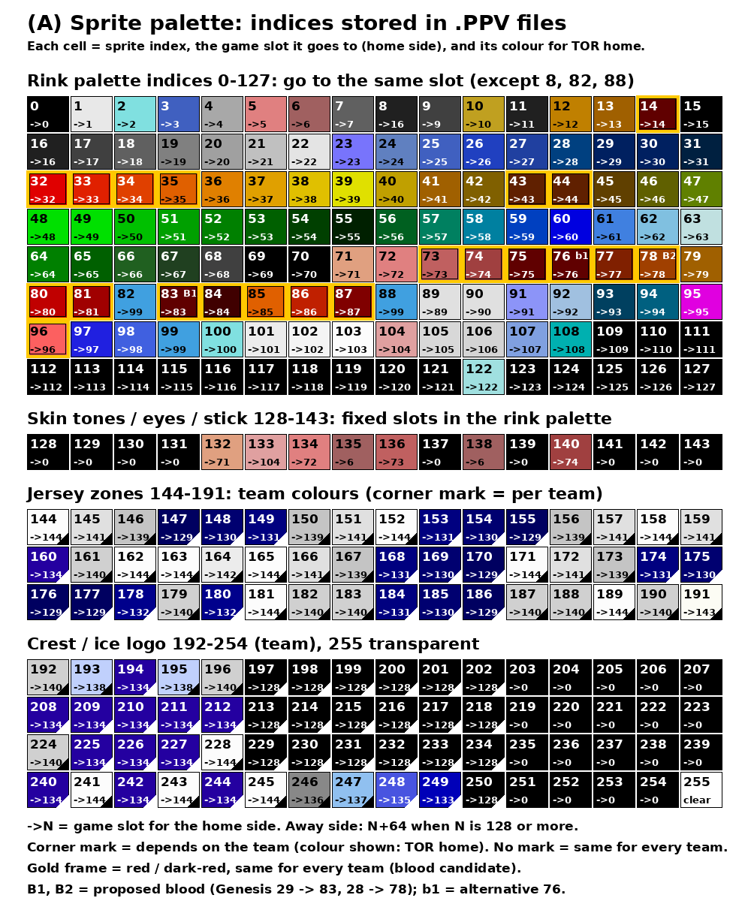
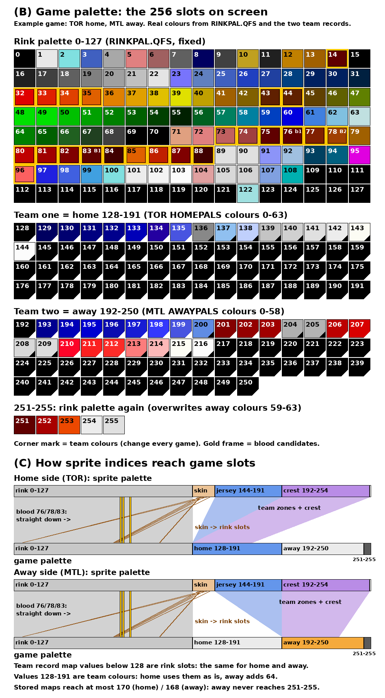

# The two 95 PC palettes, and which index the blood should use

NHLPA 93 has blood and 95 PC sprites do not, so blood needs a 95 PC index that looks right for **every** team, home or away.

95 PC has **two palettes** and a mapping between them. This is the "multi-step mapping" in Abdul's PPV-To-BMP and PAL-To-ACT tools:

- **Sprite palette** (sprite data in the .PPV files): the colour index stored in each sprite pixel, 0–255. For player and goalie sprites ("dynamic palette") it is **not** a screen colour. PPV-To-BMP extracts these "as stored … in grayscale" (`PPV-To-BMP/README.md:2-4`).
- **Game palette** (the in-game palette): the 256 colour slots on screen during play.
- **Colour mapping**: each team record maps sprite index → game slot.

| chart | what it shows |
|---|---|
|  | **(A)** `status/palette95_sprite.png`: the sprite palette by role. Each cell shows the sprite index, the game slot it goes to (home side), and its colour for TOR at home. |
|  | **(B)** `status/palette95_game.png`: the game palette as rink / team one / team two / overwritten bands, with real colours (TOR home vs MTL away). **(C)** shows how sprite index groups reach game slots, home side and away side. |

The per-index data is in `status/palette95_indices.csv`: role, stored map values, game slot (home and away), whether it is the same for every team, the colour shown, and pixel counts. `tools/palette95.py` makes all of it; set `NHL95_DIR` to your own game files. `tools/refpack.py` unpacks the .QFS files.

## Game palette (what is on screen)
| game slots | filled from | changes |
|---|---|---|
| 0–127 | **rink palette**: `RINKPAL.QFS` (one `!pal` picture, 256 × 6-bit RGB, × 4) = `PAL-To-ACT/rinkpal.act` (byte-identical) | never |
| 128–191 | **team one = home**: the 64 colours of the home team's HOMEPALS record (record bytes 0–191) | every game |
| 192–250 | **team two = away**: away record colours 0–58 | every game |
| 251–255 | **rink palette again**: overwrites away colours 59–63 | never |

**Overwritten slots: exactly 5, game slots 251–255.** The away team's last 5 colours (59–63) never reach the screen.
- `PAL-To-ACT/mergePal.js:52-55,57-68`: when the first file is a rinkpal, the output is rink 0–127, then the team file up to byte 753 (slot 250), then rink bytes 753–767 (slots 251–255).
- `PAL-To-ACT/README.md:285`: "overwrite the first 128 colours and last 5 colours … with the Rink Palette".
- `PAL-To-ACT/README.md:303`: "of last 64 colours (192-255), 5 for rink pal".
- NHL9XStudio `lib/pc-jersey.js:211-212`: LoadTeamPalette copies the away record's 64 colours to 192–255, then copies RINKPAL `!pal` bytes 0x2F1–0x2FF over 251–255.
- NHL9XStudio `lib/pc-rink.js:17-18,44-50,55-62`: the same bands; away is filled for i < 59 only.

What the 5 slots hold (`RINKPAL.QFS`):

| slot | colour |
|---|---|
| 251 | (96,0,0) |
| 252 | (168,0,0) |
| 253 | (236,72,0) |
| 254 | (236,236,236) |
| 255 | (224,224,224) |

255 is transparent: the blitter skips it (`pc-rink.js:49`). `RINKPAL2.QFS` has 0 in 251–254. **What 251–254 are used for is not shown by the code or the data I have.** None of the art I counted (player banks, RINK.QFS, the other SPIT banks) uses slots 251–254. Two possibilities: something sets them at run time, or the HUD files I could not decode use them (see the end of this page).

## Sprite palette → game slot (the colour mapping)
Each 448-byte team record holds 64 colours (bytes 0–191) and a 256-byte map (bytes 192–447): sprite index → game slot. The table below is checked on all 56 records (28 HOMEPALS + 28 AWAYPALS).

| sprite index (sprite palette) | stored map value | game slot, home | game slot, away | same for every team? |
|---|---|---|---|---|
| 0–127 (rink palette indices) | itself, except **8 → 16**, **82 and 88 → 99** | same | same | yes |
| 128–143 skin tones / eyes / stick | 132→71, 133→104, 134→72, 135→6, 136→73, 138→6, 140→74, the rest → 0 | same | same | yes (rink slots) |
| 144–191 jersey zones (forearm … helmet) | 128–170 | 128–170 | **+64** = 192–234 | no |
| 192–254 crest / ice logo | 0 or 128–170 | same | team values +64 | no |
| 255 | — | transparent | transparent | — |

- **Map bytes 192–319** (sprite 0–127) are the block `PAL-To-ACT/README.md:222` asks about ("values 0-127 - maybe a reference to rink/game palette?"). They are the identity map for the rink indices, with 3 exceptions: 8 → 16, and 82, 88 → 99.
- **binToAct reads only map bytes 320–447** (`binToAct.js:38,223-229`, sprite 128–255). That explains `rinkpalShadowfixed.act` (`PAL-To-ACT/README.md:280`): it patches slots 82 and 88 to the colour of slot 99, (64,160,224), exactly what the record map does.
  - It patches slot 8 to (0,64,128). The record map sends sprite 8 to slot 16, which is (32,32,32).
  - So the BMPs extracted with `createPal` show sprite 8 (blade side) bluer than the game does.
- **Away side, +64.** AWAYPALS maps store team values in the same 128–191 space as HOMEPALS (away max 168, home max 170). For the away team they must be shifted into 192–255. NHL9XStudio documents this +64 for the HUD crest remap (`pc-jersey.js:71`).
  - Map values below 128 (rink slots: skin 71/104/72/6/73/74, black 0, blade 16, shadow 99) cannot be shifted. Otherwise every away player's skin and shadow would become team colours.
  - Because the largest stored value is 170, no sprite index ever reaches slots 251–255, home or away.
- **Static sprites** (referee, nets, siren, glass) and `RINK.QFS` use the game palette directly, without the team map (`PPV-To-BMP/README.md:4`). For 0–127 this makes no difference, except 8, 82 and 88.

## Blood candidates
Red and dark-red sprite indices whose game slot is the same for every team, home and away. They have gold frames in charts A and B. Colours are from the rink palette.

The pixel-count columns hold the raw stored value:
- **player px**: the numbered player banks;
- **rink px**: `RINK.QFS`;
- **other px**: GOAL, SIREN, CROSS, NUMSHP, SCRBRD1/2, TRINKND, GUILT, HOOK, RUFF, CLAP, FANOM, GADGET5/6, CFLAG, UFLAG, SAVED, CRESTS4, F000_149.

| sprite index → game slot | colour | player px | rink px | other px | where 95 PC uses it |
|---|---|---|---|---|---|
| **83 → 83** | (96,0,0) | 176 | 0 | 135 | siren 554–567, broken glass 645–648 |
| **78 → 78** | (160,64,0) | 7 | 78 | 22 | glass 647/648, Stanley Cup 866–871 |
| **76 → 76** | (96,0,0) | 0 | 0 | 56 | only in F000_149 (may use a menu palette) |
| 75 → 75 | (96,0,0) | 1 | 0 | 95 | 1 px in glass 648 |
| 14 → 14 | (96,0,0) | 2 | 1,456 | 221 | rink art |
| 84 → 84 | (64,0,0) | 1 | 299 | 280 | rink art |
| 87 → 87 | (128,0,0) | 186 | 0 | 6 | siren |
| 81 → 81 | (160,0,0) | 0 | 128 | 444 | rink art |
| 86 → 86 | (192,32,0) | 180 | 0 | 15 | siren, glass, 1 px each in 95 PC injury 633/634 |
| 80 → 80 | (192,0,0) | 1,122 | 210 | 22,495 | referee and other art |
| 32 → 32 | (224,0,0) | 198 | 16 | 18,674 | net and other art |
| 82 → **99** | shows (64,160,224) | | | | **not usable**: the map sends it to the shadow slot |

## The NHLPA 93 blood: decided
**Approved by Abdul (27 Nov 2026): Genesis 29 → sprite index 76, Genesis 28 → 78.** Applied through `decisions/abdul_decisions.csv`; the status sheets show 76 as wine (100,30,60) and 78 as orange (255,150,0), guide colours added on top of his ACT.

The analysis behind it. The first proposal was 83 for Genesis 29; Abdul picked the alternative, 76 (same colour, used by no on-ice art, so blood gets its own slot).

The Genesis blood uses two colours: value 29 (108,0,0), most of the blood, and value 28 (180,72,0).

| Genesis | sprite index | game slot (home and away) | colour | why |
|---|---|---|---|---|
| 29 (108,0,0) | **83** | 83 | (96,0,0) | closest dark red; already drawn on the ice by 95 PC player-bank sprites (siren, broken glass) |
| 28 (180,72,0) | **78** | 78 | (160,64,0) | closest colour; already used on the ice (glass, Stanley Cup) |

- **It holds under the double mapping.** In all 28 HOMEPALS and 28 AWAYPALS records, the map value for sprite 83, 78 and 76 is 83, 78 and 76: a rink slot, below 128. So the game slot is the same for every team on both sides, and it is never in the team bands or in 251–255.
- **76 (chosen for 29)** has the same colour as 83 but no on-ice art uses it, so it is a blood-only slot if the rink palette is ever edited.
- **Brighter pair:** 81 (160,0,0) with 86 (192,32,0).
- **Never use:**
  - 82 or 88 (they map to the shadow slot 99);
  - 8 (maps to 16);
  - anything in 144–254 (team colours; 251–254 map to 0).
- **Still to do:** try it in the game. Whether the game changes rink slots 0–127 during play has not been checked.

## Stray pixels in the fight frames: done
Abdul's complete guide palette (`abdul/act/abdul_palette_complete.act`) colours three gaps in his BMP. The two fight-frame colours that looked like strays are his own zone colours for 135 and 178.

| colour in the PSD | index | zone |
|---|---|---|
| (160,96,96) | **135** | skin dark; it also shows rink slot 6 = (160,96,96) in game |
| (0,170,0) | **178** | pants stripe 2 |
| (74,173,134) | **164** | goalie mask |

With the complete palette, 359–362 were FULL. The rest:
- 354–357: 1–2 grey Genesis pixels each.
- 368: one pixel of (255,199,154) on light skin → **133** (approved).
- 354–357: the grey Genesis pixels → the index of their zone, from the same Genesis value next to them (approved rule). All 9 fight frames are now FULL; every changed pixel is in `frames_pc/decisions_applied.csv`.

## Notes and limits
- `SCRBRD2.QFS` and `PSTATBAR.QFS` (HUD) are not counted: `tools/refpack.py` unpacks `SCRBRD2.QFS` 2 bytes longer than its header says, and neither then parses, so I left them out rather than guess.
- `F000_049`, `F050_099` and `F100_149` are byte-identical subsets of `F000_149`, so only `F000_149` is counted.
- `PAL-To-ACT/README.md:160-162` lists stick as sprite 135. The records map 136 → slot 73 ("Stick - 73" in the game palette list), and 135 → slot 6 (a skin colour).
