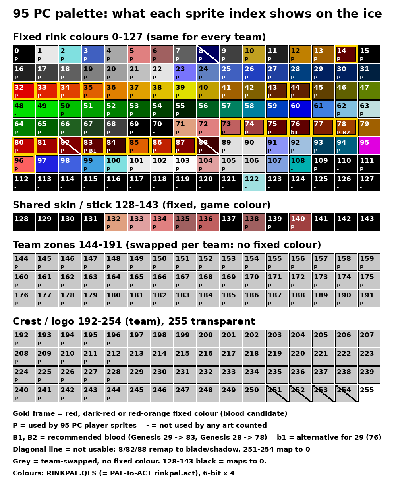

# The 95 PC palette: which colours a sprite can use

Why this matters: NHLPA 93 has blood and 95 PC sprites do not, so blood needs a 95 PC index that looks right for **every** team. A few stray pixels in the fight frames also need an index.

Per-index data: `status/palette95_indices.csv` (rink RGB, role, what the team records map it to, pixel counts). Made by `tools/palette95.py` (set `NHL95_DIR` to your own NHL 95 PC game files; `tools/refpack.py` unpacks the .QFS files).

## How the in-game palette is built
Sources: NHL9XStudio `lib/pc-jersey.js` and `lib/pc-rink.js`, checked against the game files.

| game palette index | filled from | changes per team? |
|---|---|---|
| 0–127 | `RINKPAL.QFS` (an SHPI with one `!pal` picture: 256 × RGB, 6-bit, × 4 = 8-bit). Same colours as `PAL-To-ACT/rinkpal.act` in this repo | no |
| 128–191 | home team record: 64 colours (bytes 0–191 of the 448-byte record in `HOMEPALS.BIN`) | yes |
| 192–255 | away team record (`AWAYPALS.BIN`, same layout, +64) | yes |

`RINKPAL2.QFS` differs from `RINKPAL.QFS` only at 251–254. `rinkpalShadowfixed.act` differs at 8, 82 and 88.

A **sprite** pixel is not a game palette index. Each team record also holds a 256-byte map (bytes 192–447): sprite index → game palette index. Across all 56 records (28 home + 28 away):

| sprite index | maps to | so it shows |
|---|---|---|
| 0–127 | itself (except 8 → 16, 82 and 88 → 99) | the fixed rink colour, the same for every team |
| 8 | 16 (32,32,32) | dark grey (blade side) |
| 82, 88 | 99 | the shadow colour; **88 is the 95 PC shadow** (36,706 px) |
| 128–143 | fixed: 132 → 71, 133 → 104, 134 → 72, 135 → 6, 136 → 73, 138 → 6, 140 → 74, the rest → 0 | skin, eyes, stick; the same for every team |
| 144–191 | team colours 128–170 (home) or the away range | the 48 jersey zones, different per team |
| 192–250 | team colours | crest / ice logo, different per team |
| 251–254 | 0 | black; not usable |
| 255 | — | transparent |

**Rule for blood (and anything else that must not change with the team): use a sprite index in 0–127 other than 8, 82 and 88, or one of the fixed 128–143.**

Pixel counts in the CSV: `player_px` = all numbered 95 PC player banks (`NNN_NNN.PPV`, `NNNNNNNN.PPV`); `rink_px` = `RINK.QFS`; `other_px` = the other SPIT banks (GOAL, SIREN, CROSS, NUMSHP, SCRBRD1/2, TRINKND, GUILT, HOOK, RUFF, CLAP, FANOM, GADGET5/6, CFLAG, UFLAG, SAVED, CRESTS4, F*.PPV). The F*.PPV banks may be drawn with a menu palette, so their use of an index says less about the ice. SCRBRD2.QFS and PSTATBAR.QFS are not counted.

## Red and dark-red fixed colours (blood candidates)
Gold frames in the image. RGB from `RINKPAL.QFS`.

| sprite index | RGB | player px | rink px | other px | where 95 PC uses it |
|---|---|---|---|---|---|
| 14 | (96,0,0) | 2 | 1,456 | 413 | rink art |
| 75 | (96,0,0) | 1 | 0 | 190 | 1 px in glass 648; F*.PPV |
| **76** | (96,0,0) | 0 | 0 | 112 | not used on the ice at all (F*.PPV only) |
| 77 | (128,32,0) | 0 | 0 | 70 | F*.PPV |
| **78** | (160,64,0) | 7 | 78 | 42 | broken glass 647/648, Stanley Cup 866–871 |
| 81 | (160,0,0) | 0 | 128 | 888 | rink art, F*.PPV |
| 82 | (128,0,0) | 278 | 456 | 5 | **not usable** (shows the shadow) |
| **83** | (96,0,0) | 176 | 0 | 270 | siren 554–567, broken glass 645–648 |
| 84 | (64,0,0) | 1 | 299 | 558 | |
| 86 | (192,32,0) | 180 | 0 | 30 | siren, glass, and 1 px each in 95 PC injury 633/634 |
| 87 | (128,0,0) | 186 | 0 | 12 | siren |
| 80 | (192,0,0) | 1,122 | 210 | 22,804 | referee and other art |
| 32 | (224,0,0) | 198 | 16 | 18,683 | net, other art |
| 33 | (224,32,0) | 1,756 | 64 | 7,237 | referee |
| 34 | (224,64,0) | 14 | 8 | 3,047 | |
| 73 | (192,96,96) | 932 | 513 | 1,380 | also what stick/skin 136 shows |
| 74 | (160,64,64) | 81 | 20 | 396 | also what 140 shows |
| 5 | (224,128,128) | 97 | 590 | 1,310 | broken glass |
| 6 | (160,96,96) | 37 | 1,247 | 804 | also what skin 135/138 show |

## Recommendation for the NHLPA 93 blood
The Genesis blood uses two colours: value 29 (108,0,0), most of the blood, and value 28 (180,72,0).

| Genesis | 95 PC sprite index | RGB | why |
|---|---|---|---|
| 29 (108,0,0) | **83** | (96,0,0) | closest dark red; already drawn on the ice by 95 PC player sprites (siren, broken glass), so it is known to show correctly in game |
| 28 (180,72,0) | **78** | (160,64,0) | closest colour; already used by 95 PC player sprites (glass, Stanley Cup) |

- Alternative for 29: **76**, the same RGB as 83 but used by no on-ice art. Pick it if blood should have its own slot, so a future rink-palette edit could retint blood without touching the siren or glass.
- Brighter pair if the blood looks too dark in game: **81** (160,0,0) for 29 and **86** (192,32,0) for 28.
- Never 82 or 88 (they show the shadow), 8 (dark grey) or 251–254 (black), and nothing in 144–250 (changes with the team).
- None of these indices is in Abdul's guide palette BMP, so on the status sheets they show in the cyan fallback colour.
- Still to do: try it in the game. Whether the game changes any of 0–127 during play has not been checked.

## The stray fight pixels (group 1 in PLAN.md)
| colour in the PSD | where | likely 95 PC index |
|---|---|---|
| (160,96,96) | 3 px on dark skin | **135** (skin dark): 135 and 138 both show rink 6 = (160,96,96) exactly |
| (0,170,0) | 6–8 px per frame, a vertical line 48–70% down the frame next to 179 *pants stripe 1* and 177/180 | **178** *pants stripe 2*. 178 is not in Abdul's guide BMP, which explains the off-guide green |
| (255,199,154) | 1 px on light skin | **133** (shows 104 = (224,160,160)) or **132** (shows 71 = (224,160,128)). Abdul to decide |
