# NHL94-colored-faces

> **Making a mod, hack, port or other derivative work from these faces? You must credit me (abdulahmad), clearly, in your own repo and in every release. See [Credits and derivative works](#credits-and-derivative-works).**

> **AI usage:** these faces were made with AI assistance, directed and reviewed by hand face by face. See [AI assistance](#ai-assistance).

All 144 player photos in NHL '94 (Sega Genesis), plus the 2 extra faces on NHL '94 for Sega CD, in
colour. Each face is a 48 x 48 PNG of the game's own grey picture, pixel for pixel, with colour added.
The cartridge's faces are one file per card, `CardNNN_Name.png`, where the card number is the
picture's order in the ROM. The Sega CD's are `SegaCD_Team_Name.png`.

- `faces.csv` gives each file's player, team and where its colour came from.
- `faces/` holds the colour faces.
- `sources/` holds the picture each face's colour came from (see [The colour sources](#the-colour-sources)).
- `docs/` holds the pictures on this page: `contact-sheet.png` (the cartridge's 144 at 2x), a sheet for each group (`group-*.png`), and the examples.

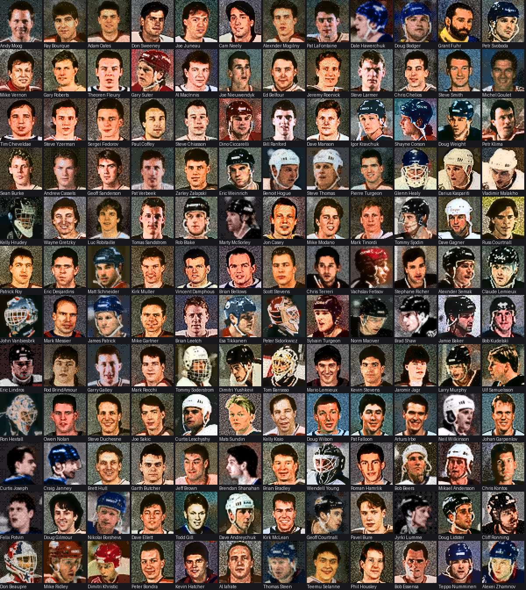

## How they were coloured

Every face keeps the cartridge picture's shape and most of its light. The colour comes from another
picture, lined up over the cartridge's. If there was no other copy of the photo, the colours were
painted into regions. A face's group depends on where its colour came from:

| How | Faces |
|---|--:|
| [The same photo in NHL 95 PC](#the-same-photo-in-nhl-95-pc) | 89 |
| [The same photo in NHL 94 PC](#the-same-photo-in-nhl-94-pc) | 32 |
| [The same photo in NHL 95 SNES](#the-same-photo-in-nhl-95-snes) | 9 |
| [The back of EA's 1993-94 NHL '94 card](#the-back-of-eas-1993-94-nhl-94-card) | 3 |
| [A 1992-93 Bowman card](#a-1992-93-bowman-card) | 3 |
| [Colours from a different photo](#colours-from-a-different-photo) | 1 |
| [Hand coloured](#hand-coloured) | 9 |
| **All** | **146** (144 cartridge, 2 Sega CD) |

### The same photo in NHL 95 PC

95 PC has the same photo as the player's portrait (`PORTRnnn.QFS` on its disc). The portrait is
lined up on the grey card. The card keeps its own shading and takes the portrait's colour. That covers
**89 faces** (88 cartridge, plus Rick Tocchet from the Sega CD).

Viacheslav Fetisov is the same photo too, but the cartridge's copy is stretched about 16% wider and
cropped differently, so it can't be lined up pixel for pixel. His colours were taken from the portrait
region by region (skin, helmet, jersey, background) and painted into the same regions on the card.

| Cartridge | Source | Colour |
|:-:|:-:|:-:|
| 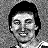 |  |  |
| cartridge (grey) | 95 PC portrait | Wayne Gretzky |
|  |  |  |
| cartridge (grey) | 95 PC portrait (colours by region) | Vachslav Fetisov |

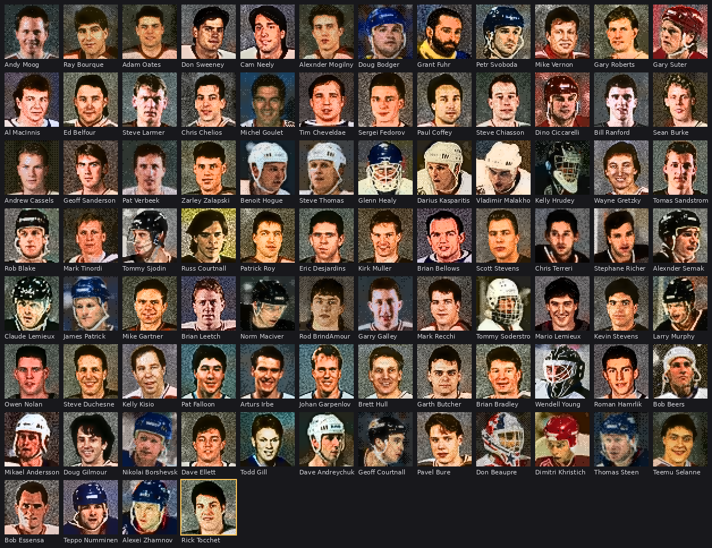

### The same photo in NHL 94 PC

This is used where 95 PC has no copy of the photo; the portraits are in 94 PC's `PORTRAIT.NSH`.
94 PC's pixels aren't square, so each portrait is narrowed to about 0.84 of its width to fit.
**32 faces**.

| Cartridge | Source | Colour |
|:-:|:-:|:-:|
|  | 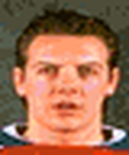 |  |
| cartridge (grey) | 94 PC portrait | Theoren Fleury |

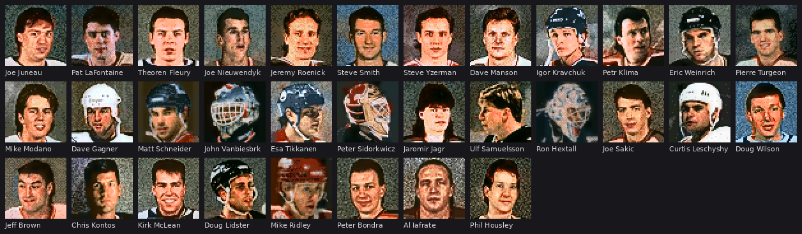

### The same photo in NHL 95 SNES

The 95 SNES cartridge has smaller, rougher copies of some photos. Where the SNES cut the player
out of the photo, the background is a calm grey-brown. **9 faces** (8 cartridge, plus Jari Kurri from the Sega CD).

| Cartridge | Source | Colour |
|:-:|:-:|:-:|
| 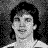 |  |  |
| cartridge (grey) | 95 SNES photo | Luc Robitaille |

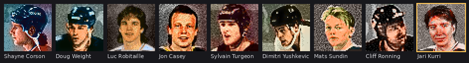

### The back of EA's 1993-94 NHL '94 card

The backs of EA Sports' own NHL '94 cards show the cartridge's head shot in colour, about three times
bigger. Each head was taken from a scan of the card back. Contrast was fixed where needed, the head was
straightened, then it was lined up. **3 faces**.

| Cartridge | Source | Colour |
|:-:|:-:|:-:|
|  |  |  |
| cartridge (grey) | card back (head) | Bob Kudelski |
|  |  | 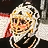 |
| cartridge (grey) | card back (head) | Tom Barrasso |
| 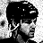 |  | 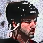 |
| cartridge (grey) | card back (head) | Jamie Baker |

### A 1992-93 Bowman card

The same photo, mirrored, is on the player's 1992-93 Bowman card. A card photographed at an angle was
flattened first, then mirrored and lined up. **3 faces**.

| Photo of the card | Flattened |
|:-:|:-:|
| 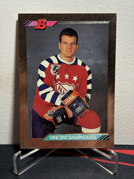 | 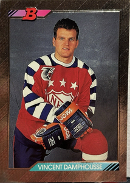 |

| Cartridge | Source | Colour |
|:-:|:-:|:-:|
|  |  | 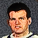 |
| cartridge (grey) | card (flattened, mirrored) | Vincent Damphousse |
|  |  | 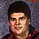 |
| cartridge (grey) | card (flattened, mirrored) | Kevin Hatcher |
|  | 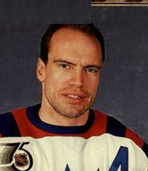 |  |
| cartridge (grey) | card | Mark Messier |

### Colours from a different photo

No copy of Eric Lindros's cartridge photo was found. His skin, jersey, helmet and background colours
were taken from a different photo of him in a Flyers jersey (only his head is shown here) and painted
into the matching regions. The orange is at half strength, and the shoulder yoke and collar are white.
**1 face**.

| Cartridge | Source | Colour |
|:-:|:-:|:-:|
| 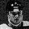 | 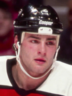 |  |
| cartridge (grey) | another photo (head) | Eric Lindros |

### Hand coloured

These players have no colour copy of the photo anywhere. The regions were drawn by hand: skin, hair, and
the jersey and helmet in the away colours of the team the player is on (or was on when the photo was taken). For
Janney and Hawerchuk, Abdul painted where the skin, the team colours and the background go (green is
background, magenta is skin). **9 faces**.

| Cartridge | Source | Colour |
|:-:|:-:|:-:|
|  |  |  |
| cartridge (grey) | Abdul's outline | Craig Janney |
|  |  | 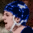 |
| cartridge (grey) | Abdul's paint map | Dale Hawerchuk |

| Player | Team colours |
|---|---|
|  Dale Hawerchuk | Buffalo away |
| 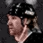 Marty McSorley | Los Angeles away |
|  Brad Shaw | Ottawa away |
|  Neil Wilkinson | San Jose |
|  Curtis Joseph | St. Louis away |
|  Craig Janney | St. Louis away |
|  Brendan Shanahan | St. Louis away |
|  Felix Potvin | Toronto away |
|  Jyrki Lumme | Vancouver away |

## The Sega CD's own faces

NHL '94 for Sega CD has photos of two players that the cartridge has no photo of: Jari Kurri and Rick
Tocchet. Every other disc-only player gets one of the disc's two stock pictures (a skater and a goalie),
so those aren't included. Both faces were coloured in the same way as the cartridge's and are counted in
the groups above.

- **Jari Kurri**: the same photo is in NHL 95 SNES. The background is a calm grey-brown.
- **Rick Tocchet**: coloured from his NHL 95 PC portrait, which is a very close shot. The colour that
  spilled onto his shoulder at the bottom right was set to the background's, and the collar was kept white.

| Sega CD (grey) | Source | Colour |
|:-:|:-:|:-:|
|  |  | 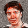 |
| Sega CD (grey) | 95 SNES photo | Jari Kurri (LA) |
| 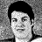 | 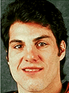 |  |
| Sega CD (grey) | 95 PC portrait | Rick Tocchet (PIT) |

## Players with a stock picture

In the game, the starters of Anaheim and Florida have no photo: on the cartridge and on the Sega CD they
get a stock picture (a skater or a goalie). On the Sega CD the same goes for Mike Richter, the Rangers'
starting goalie there. These 12 faces are made from scratch for them, from EA's 1993-94 NHL '94 card
of each player, since there is no grey picture to colour. They are `Player_Team_Name.png`.

So that they look like the rest, each one is made the way the cartridge's are: first a grey picture as
the Genesis keeps its photos (48 x 48, the same 8 greys, dithered, its tones spread like the cartridge's
pictures), then the colour put on that grey picture in the same way as on the cartridge's faces. The grey
pictures are in `docs/` (`Player_..._grey.png`). The photo each grey picture was made from:

- **The card's back, colours matched to the player's NHL 95 PC portrait** (the same photo there): Guy
  Hebert, Randy Ladouceur, Troy Loney, Gord Murphy, Joe Cirella, Scott Mellanby.
- **The card's front, colours matched to his NHL 95 PC portrait**: Andrei Lomakin, Brian Skrudland.

For these eight the card's photo was lined up with the 95 PC portrait. Hebert, Murphy, Lomakin, Skrudland
and Mellanby show the portrait's full height, top to bottom. Ladouceur, Murphy, Cirella and Lomakin have
the portrait's light as well as its colours (the cards are washed out next to it), and Lomakin's front,
a small picture, was cleaned of its noise first.
- **The card's front, contrast raised**: Terry Yake, Anatoli Semenov, Mike Richter (his mask).
- **The card's back, contrast raised**: Alexei Kasatonov.

John Vanbiesbrouck isn't here: the cartridge already has a photo of him.

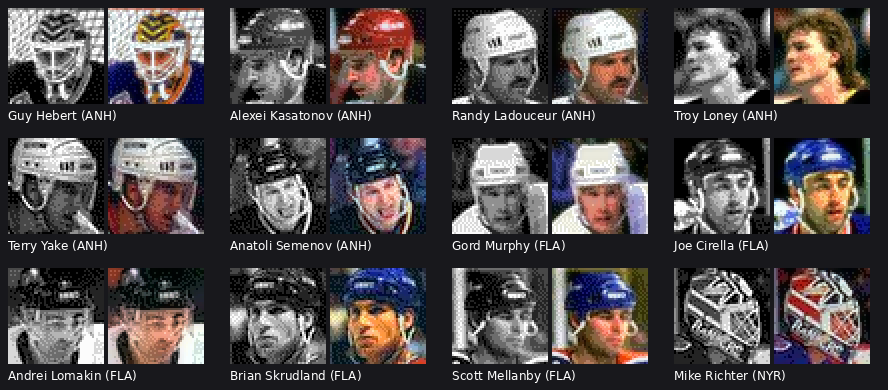

## The colour sources

`sources/` holds the picture each face's colour came from, under the face's own file name:

- the NHL 95 PC portrait (`PORTRnnn.QFS`) or NHL 94 PC portrait (`PORTRAIT.NSH`), as the game has it;
- the NHL 95 SNES photo;
- the card's photo (EA's 1993-94 NHL '94 card or a 1992-93 Bowman card), cropped to the photo;
- for Eric Lindros, the cropped head of the photo reference;
- for the `Player_` faces, the photo on the player's EA NHL '94 card (the back, or the front).

The hand coloured faces have no colour source, except Dale Hawerchuk and Craig Janney, whose paint
maps are there (`..._paintmap.png`).

## In the game

NHL94Genesis-C-Port shows these faces when "Colour player photos" is on (Game page). It looks for
this folder, `NHL94-colored-faces` (its `faces/`), beside the program, or in the folder `NHL94_COLORED_FACES` names, and
shows each card's face pixel for pixel. Cards it has no face for are coloured at run time from the
player's own NHL 95 PC and NHL 94 PC files. A `Player_` face is shown in place of the stock picture for
the player of that name, on whichever team he plays for.

## AI assistance

These faces were made with AI assistance. The colouring was directed by a strict set of rules and reviewed by
hand, face by face: each one was checked against its sources and only kept once it was approved. We
can't guarantee every face is perfect. If you see one that needs fixing, raise an issue, or even
better, raise a PR.

## Credits and derivative works

Faces by abdulahmad (https://github.com/abdulahmad/EA-NHL-Tools).

These faces are my work (abdulahmad). If you build anything from them, including mods, ROM or EXE hacks, ports, released forks, tools, or any other derivative work, you must credit me:

- Put the credit in your repo's README, near the top and not buried in a footer, and in the notes of every release you publish, including any text file shipped inside a release archive.
- Name me (abdulahmad) and link to this repository.
- If you only use part of this folder (some faces, a sheet, faces.csv, the method), the credit still applies.
- If you are unsure, over-credit.

Credit is the condition for using this work. Please do not release a derivative without it.
