# NHL94-colored-faces

All 144 player photos in NHL '94 (Sega Genesis), in colour. Each face is a 48 x 48 PNG of the
cartridge's own picture, pixel for pixel, with colour added. There's one file per card,
`CardNNN_Name.png`; the card number is the picture's order in the ROM.

- `faces.csv` gives each file's player, team and where its colour came from.
- `contact-sheet.png` shows them all at 2x.
- `how/` holds the pictures used on this page.

## How they were coloured

Every face keeps the cartridge picture's shape and most of its light. The colour comes from another
picture, lined up over the cartridge's. If there was no other copy of the photo, the colours were
painted into regions. A face's group depends on where its colour came from:

| How | Faces |
|---|--:|
| [The same photo in NHL 95 PC](#the-same-photo-in-nhl-95-pc) | 87 |
| [The same photo in NHL 94 PC](#the-same-photo-in-nhl-94-pc) | 32 |
| [The same photo in NHL 95 SNES](#the-same-photo-in-nhl-95-snes) | 8 |
| [The back of EA's 1993-94 NHL '94 card](#the-back-of-eas-1993-94-nhl-94-card) | 3 |
| [A 1992-93 Bowman card](#a-1992-93-bowman-card) | 3 |
| [Colours from a different photo](#colours-from-a-different-photo) | 2 |
| [Hand coloured](#hand-coloured) | 9 |
| **All** | **144** |

### The same photo in NHL 95 PC

95 PC has the same photo as the player's portrait (`PORTRnnn.QFS` on its disc). The portrait is
lined up on the grey card. The card keeps its own shading and takes the portrait's colour. That covers
**87 faces**.

| Cartridge | Source | Colour |
|:-:|:-:|:-:|
|  | 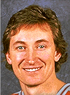 | 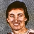 |
| cartridge (grey) | 95 PC portrait | Wayne Gretzky |

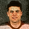
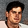

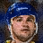
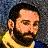
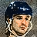
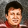
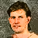
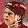
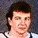
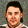
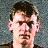
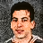
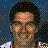
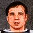
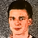
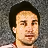
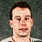
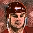
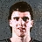

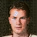

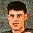
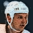
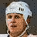
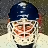
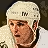
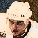
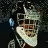

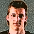
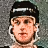
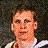
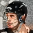

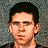

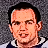

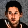
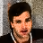
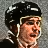
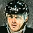
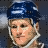

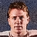
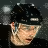
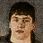
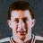
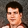
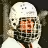

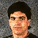
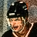
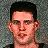

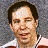

### The same photo in NHL 94 PC

This is used where 95 PC has no copy of the photo; the portraits are in 94 PC's `PORTRAIT.NSH`.
94 PC's pixels aren't square, so each portrait is narrowed to about 0.84 of its width to fit.
**32 faces**.

| Cartridge | Source | Colour |
|:-:|:-:|:-:|
|  |  |  |
| cartridge (grey) | 94 PC portrait | Theoren Fleury |

### The same photo in NHL 95 SNES

The 95 SNES cartridge has smaller, rougher copies of some photos. Where the SNES cut the player
out of the photo, the background is a calm grey-brown. **8 faces**.

| Cartridge | Source | Colour |
|:-:|:-:|:-:|
|  |  |  |
| cartridge (grey) | 95 SNES photo | Luc Robitaille |

### The back of EA's 1993-94 NHL '94 card

The backs of EA Sports' own NHL '94 cards show the cartridge's head shot in colour, about three times
bigger. Each head was taken from a scan of the card back. Contrast was fixed where needed, the head was
straightened, then it was lined up. **3 faces**.

| Cartridge | Source | Colour |
|:-:|:-:|:-:|
|  |  |  |
| cartridge (grey) | card back (head) | Bob Kudelski |
|  |  |  |
| cartridge (grey) | card back (head) | Tom Barrasso |
|  |  |  |
| cartridge (grey) | card back (head) | Jamie Baker |

### A 1992-93 Bowman card

The same photo, mirrored, is on the player's 1992-93 Bowman card. A card photographed at an angle was
flattened first, then mirrored and lined up. **3 faces**.

| Photo of the card | Flattened |
|:-:|:-:|
|  |  |

| Cartridge | Source | Colour |
|:-:|:-:|:-:|
|  |  |  |
| cartridge (grey) | card (flattened, mirrored) | Vincent Damphousse |
|  |  |  |
| cartridge (grey) | card (flattened, mirrored) | Kevin Hatcher |
|  |  |  |
| cartridge (grey) | card | Mark Messier |

### Colours from a different photo

No copy of the cartridge's photo was found for these two. Skin, jersey, helmet and background colours
were taken from another photo of the player and painted into the matching regions. **2 faces**.

- **Eric Lindros**: colours from a press photo of him in a Flyers jersey. That photo
  isn't included here because it is a news agency's photo. The orange is at half strength, and the
  shoulder yoke and collar are white.
- **Viacheslav Fetisov**: colours from his own 95 PC portrait. It is a different crop of the photo, and the
  cartridge's copy is stretched about 16% wider, so it can't be lined up pixel for pixel.

| Cartridge | Source | Colour |
|:-:|:-:|:-:|
|  | *press photo of Lindros, not included* |  |
| cartridge (grey) | (press photo, not included) | Eric Lindros |
|  |  |  |
| cartridge (grey) | 95 PC portrait | Vachslav Fetisov |

### Hand coloured

These players have no colour copy of the photo anywhere. The regions were drawn by hand: skin, hair, and
the jersey and helmet in the away colours of the team the player is on (or was on when the photo was taken). For
Janney and Hawerchuk, Abdul painted where the skin, the team colours and the background go (green is
background, magenta is skin). **9 faces**.

| Cartridge | Source | Colour |
|:-:|:-:|:-:|
|  |  |  |
| cartridge (grey) | Abdul's outline | Craig Janney |
|  |  |  |
| cartridge (grey) | Abdul's paint map | Dale Hawerchuk |

| Player | Team colours |
|---|---|
|  Dale Hawerchuk | Buffalo away |
|  Marty McSorley | Los Angeles away |
|  Brad Shaw | Ottawa away |
|  Neil Wilkinson | San Jose |
|  Curtis Joseph | St. Louis away |
|  Craig Janney | St. Louis away |
|  Brendan Shanahan | St. Louis away |
|  Felix Potvin | Toronto away |
|  Jyrki Lumme | Vancouver away |

## The Sega CD's own faces

NHL '94 on Sega CD has photos for some players that the cartridge has no photo of. There are three
new faces: Jari Kurri, Rick Tocchet and a Florida photo of John Vanbiesbrouck. Every other disc-only
player gets one of two stock pictures (a skater and a goalie). These three aren't coloured yet. They're
the disc's own 48 x 48 pictures, in grey.

| Jari Kurri (LA) | Rick Tocchet (PIT) | John Vanbiesbrouck (FLA) |
|:-:|:-:|:-:|
|  |  |  |

## In the game

NHL94Genesis-C-Port shows these faces when "Colour player photos" is on (Game page). It looks for
this folder, `NHL94-colored-faces`, beside the program, or in the folder `NHL94_COLORED_FACES` names, and
shows each card's face pixel for pixel. Cards it has no face for are coloured at run time from the
player's own NHL 95 PC and NHL 94 PC files.
