# Sprite textures: how the work was directed (process history)

This document traces how Abdul trained and steered the assistant from the first per-pixel mapping experiments (Oct 23, 2026) to the D163 handoff (Oct 25, 2026, 01:04 EDT). It is built from the rulings log in `EXPANDED_ZONES.md` and the git history (about 50 small PRs). Each stage lists what Abdul asked or ruled, what changed, the metrics before and after, and one screenshot. Screenshots are downscaled copies of the review sheets the assistant sent him, stored in `docs/process/`. No ROMs or game files are committed.

## Principles Abdul enforced throughout

1. **Show the texture used beside every preview.** "The texture previews mean nothing if you don't give me the texture you are using" (D154). Every sheet after that point draws the texture.
2. **Never relabel pixels just to hit zero.** Relabels must be real (the pixel is not that part) and are audited (D146). Settled questions are not re-asked (D140), and visible pixel matches are checked by the assistant rather than asked about (D138/D139).
3. **Straight columns and rows.** Pad stripes, then skater torso, arm and pants texel columns, must run straight and consistent across frames (D134-D136, D157/D158).
4. **Colourblind-safe, high-contrast review images.** At most 1000 px wide, big labels, no red next to green, green shown as grey, and errors ringed in yellow.
5. **Small PRs with normal merges.** One D-number per change, no force-pushes, and main checked with `git ls-remote` after each merge.
6. **Pixel perfect.** The default (control) texture must reproduce the game sprite with 0 wrong pixels.

## Stage 1: early mapping attempts (Oct 23)
- **Asked:** turn the NHL95 jersey and gear art into editable textures, then map every sprite pixel to a texel (MAPPING_PLAN with an approval gate, then a proof of concept).
- **Changed:** jersey atlases and crests; measured team specs; versions v4 to v12 of the textures; a per-pixel PoC; Abdul's own player layout (v1/v2 → v3) fitted on frame 370; then the v2 38x32 layout with a column map.
- **Metrics:** control diff on the default teams went to **0 px** (Leafs, Rangers, Chicago home/away, Montreal).
- 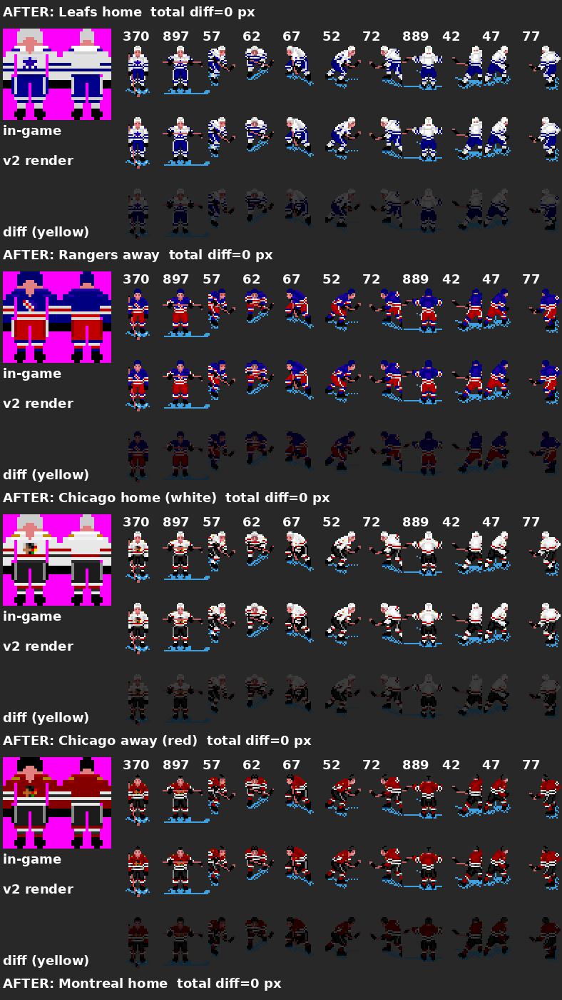

## Stage 2: goalie layout choices
- **Asked:** a goalie gear texture (pads L/R, blocker, catcher, mask with cage), with the texture shown beside previews and kept paintable.
- **Changed:** the first pass reached 0 control errors on 8 frames (D14-D19, D27-D33). From Abdul's own goalie texture (D72) came v2/v10b with pad backs and a horizontal catcher; v12 dropped the unused 8x12 catcher and repacked to **23x32** (D96/D97).
- **Later choice (D150/D151):** a draft per-pixel layout of **64x78** raised the per-pixel share (mask 48→86%) but turned gloves and pads into averaged collages that would be hard to paint. Abdul ruled "Current": **23x32 kept, 64x78 rejected.**
- 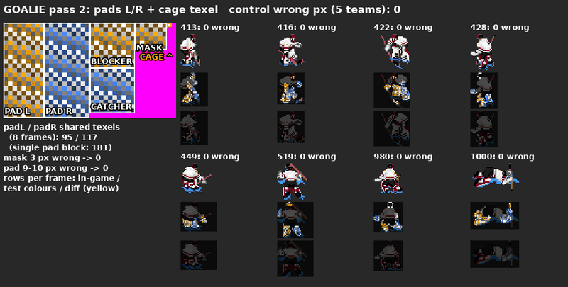
- 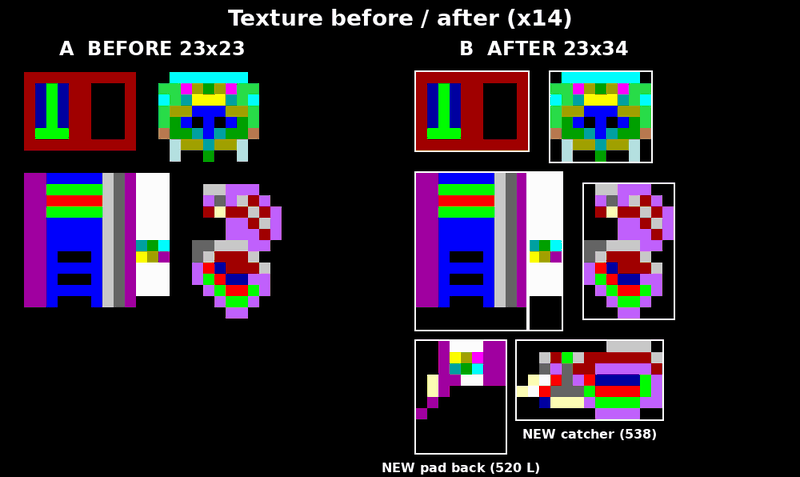
- 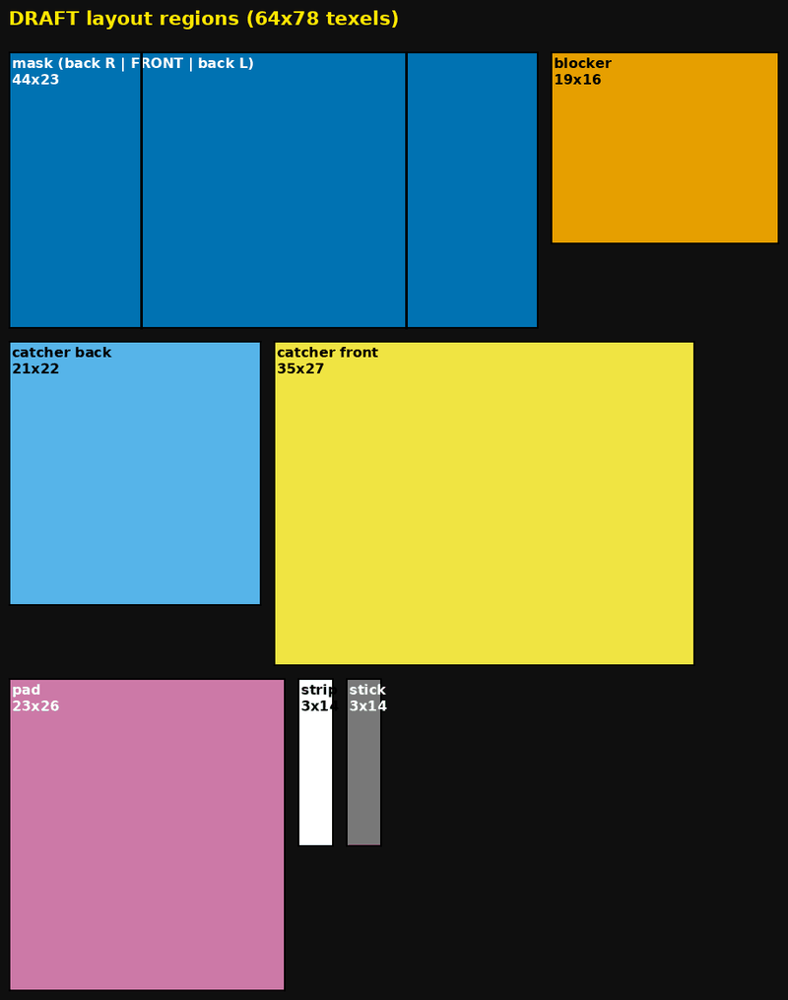

## Stage 3: cuff, pads, mask, blocker, catcher and stick to 0 strict errors (D98-D144)
- **Asked:** strict matching, where every pad pixel counts and there is no shading exemption (D101). Abdul painted ground truth green on inspection panels (538 blocker D122, 419 catcher D125) and answered questions about specific pixels (D123/D124). Then: straight pad stripes, a visible cuff, and pad direction taken from the hip→ankle skeleton (D134-D136). The 12 still-off pads were left as they are (D137).
- **Changed:** segmentation maps, then a fitted and multi-facing skeleton (D105-D113). Sock shading went into texture v6 (D109). Pads were mapped in two pieces, then recursively (D126/D127). The blocker and catcher strict fixes and a stick region came next (D141/D142), along with a part/skeleton editor (D143).
- **Metrics (strict errors):** 89 → 50 (g15) → 49 → 42 (g17) → 14 (g22) → **0 pad errors** (g23). Blocker 47 → **0** and catcher 1 → 0 (D141). **0 on all 246 goalie frames** (D144).
- 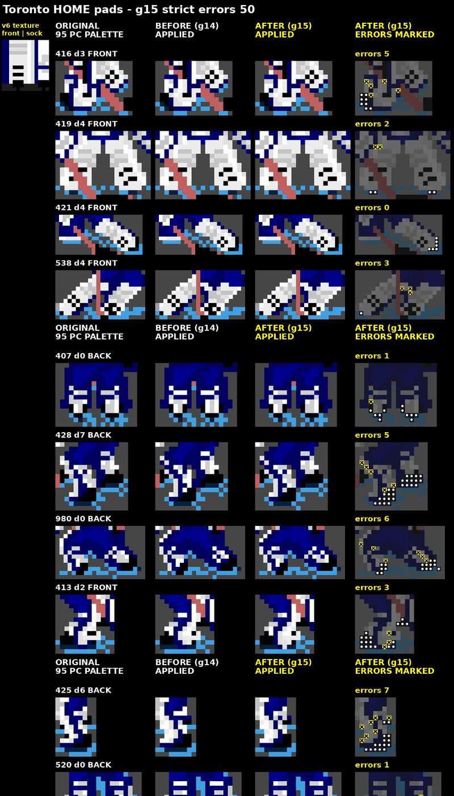
- 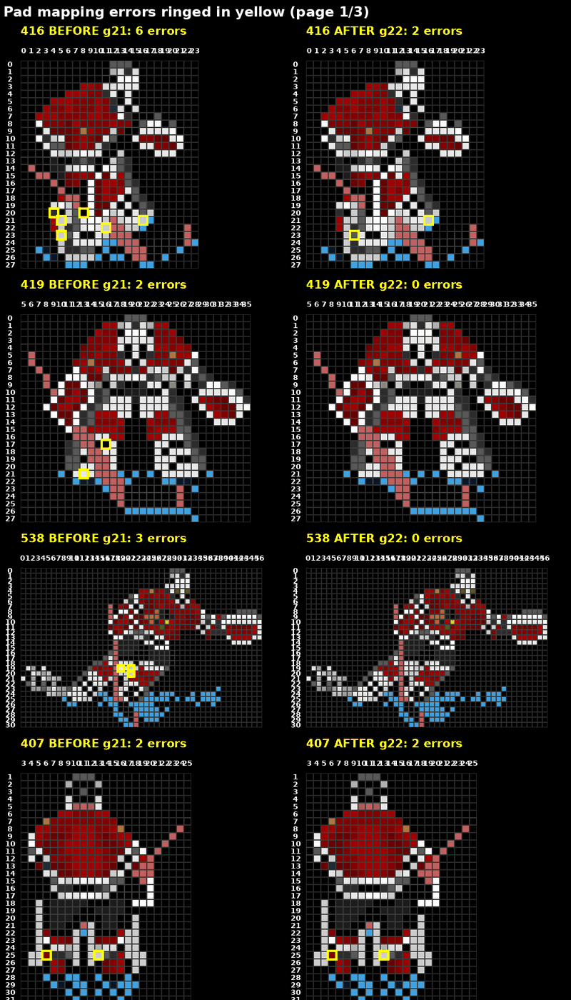 (an error grid with no texture panel; the texture is in the g15 sheet above)

## Stage 4: Fuhr texture (D128-D140, v14)
- **Asked:** a Grant Fuhr Oilers gear texture in the current layout. The mask strip is the centre FRONT (D129). The mask is symmetric with more orange on top (D133), and the navy pad stripe is one straight column (D135). The cuff and V tip stay as in v12, and settled points are not re-asked (D140).
- **Changed:** Fuhr v8 → v14, built from Abdul's high-res references (kept local) and rendered on all 246 frames.
- 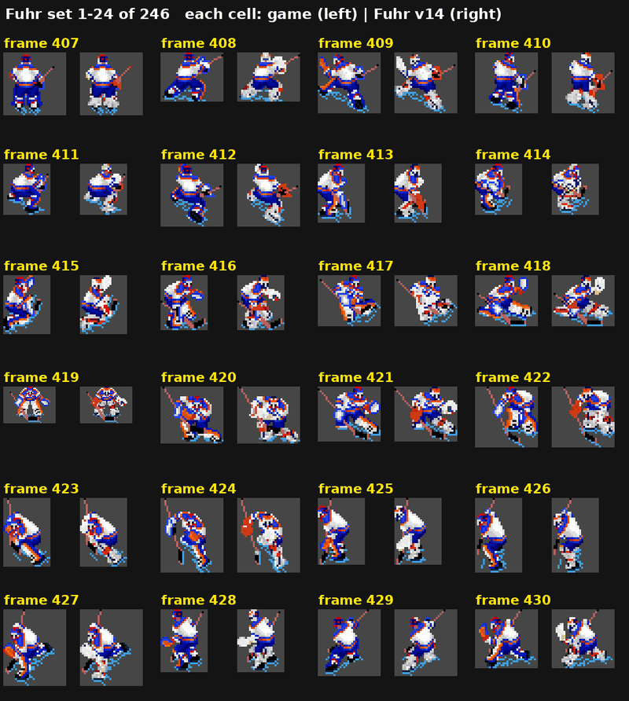 (game | Fuhr v14 only; for the texture, see the Stage 6 sheet)

## Stage 5: D145-D152 audits and leg fixes
- **Asked:** eye holes in the mask (D145). An audit of every D144 relabel (D146) proved each one was a different part, not a shortcut taken to hit zero. D152: leg pixels in pad colours that D146 had made body are pads, and the 407 helmet is mask.
- **Metrics:** 3 frames changed (540: 57 px, 1040: 16, 1059: 5). Default texture still **0 errors** (pads 17381 → 17454 ok).
- 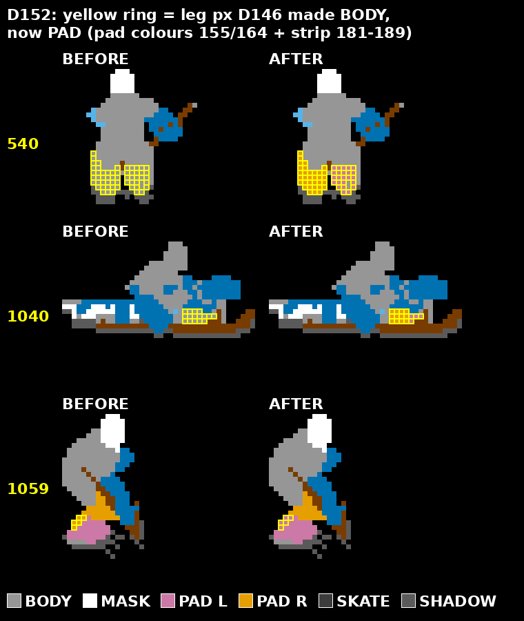

## Stage 6: editors, test textures and full goalie render (D148-D155)
- **Asked:** a skater part/skeleton editor (D148). Test textures in both editors (D149/D153). "Give me the texture you are using" (D154). Strict texels for 1-3 px pad pieces (D155).
- **Changed:** 13 test textures (UV gradient, checker, candy stripe, pad lines). Skater preview coverage went 11 → **601/881** frames through auto-fit.
- **Metrics:** full render of 246 goalie frames on default v8: **0 errors**. Fuhr v14 now textures the small pad pieces.
- 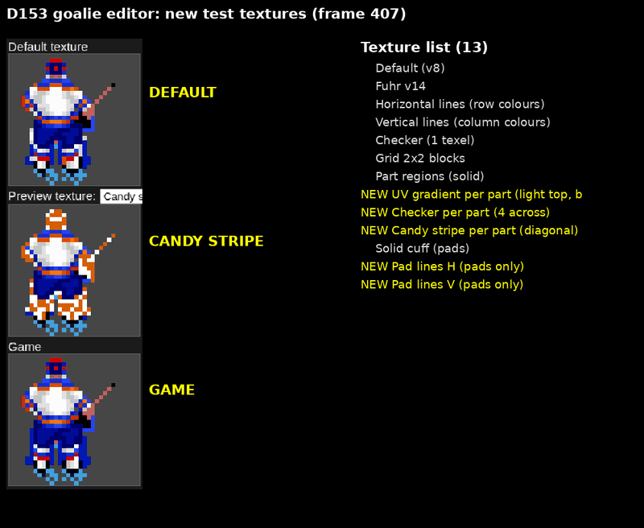
- 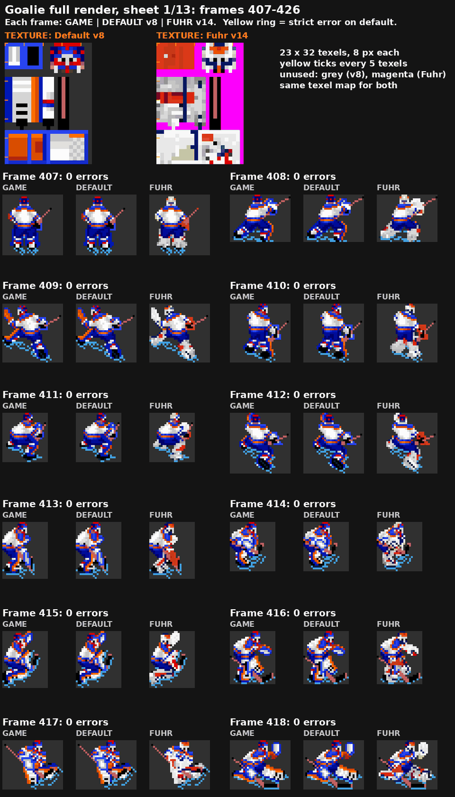

## Stage 7: skater back views (D156)
- **Asked:** auto-fitted back views must use the back-torso columns.
- **Metrics:** agreement with the hand maps on back and side frames went from 70-95% to **100%**. 375 auto frames changed (19912 px).
- 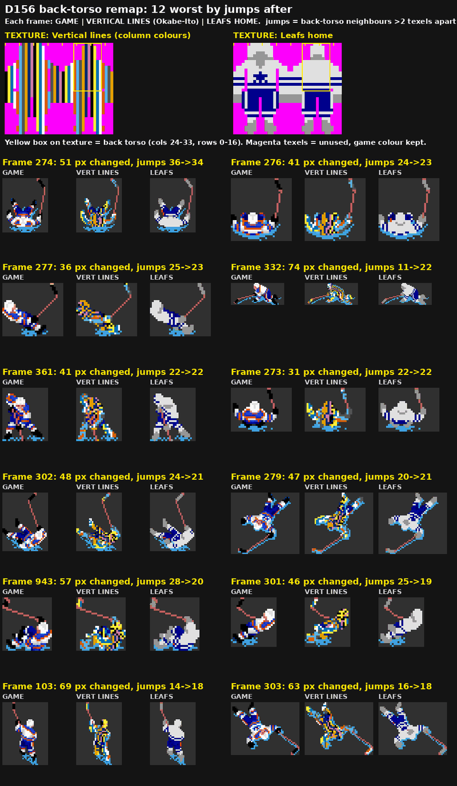 (green in the Leafs texture shown grey)

## Stage 8: column straightness (D157/D158, option c)
- **Asked:** straight texel columns on the arms and torso. Shown three options (a = straight columns where the band match may break, b = a with a redrawn texture, c = D157 strict colour-band columns), Abdul chose **c** (D158).
- **Metrics:** column offsets over 1 px went from 25.2% to 20.9%. Back-torso jumps went from 13.3% to 7.9%, with wrong colour band still 0.
- 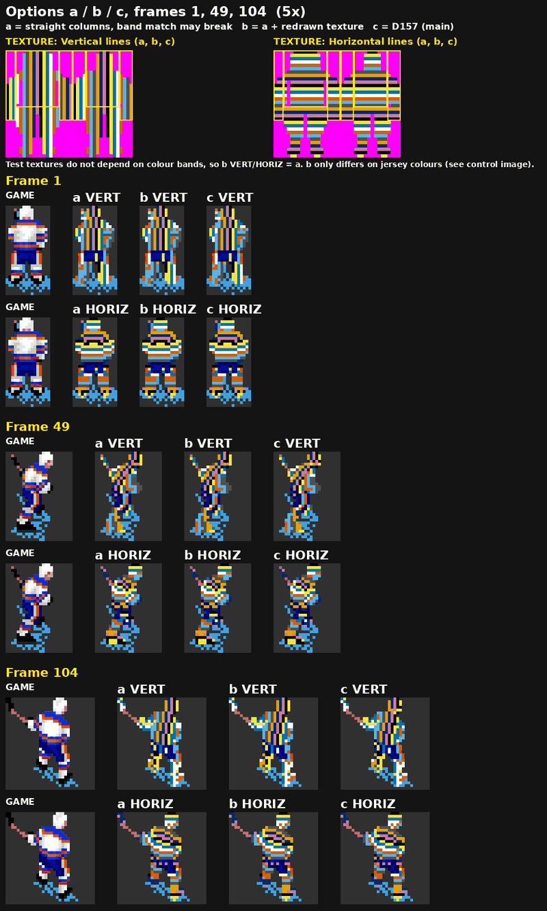

## Stage 9: pants (D159/D160)
- **Asked:** map the pants pixels, then the remaining hem pixels **without relabelling**.
- **Metrics:** pants pixels with no texel went 10512 → 1162 (D159) → **0** (D160), and from 235 → 7 → 0 on the hand frames. Wrong band stayed 0 and no existing mapping changed.
- 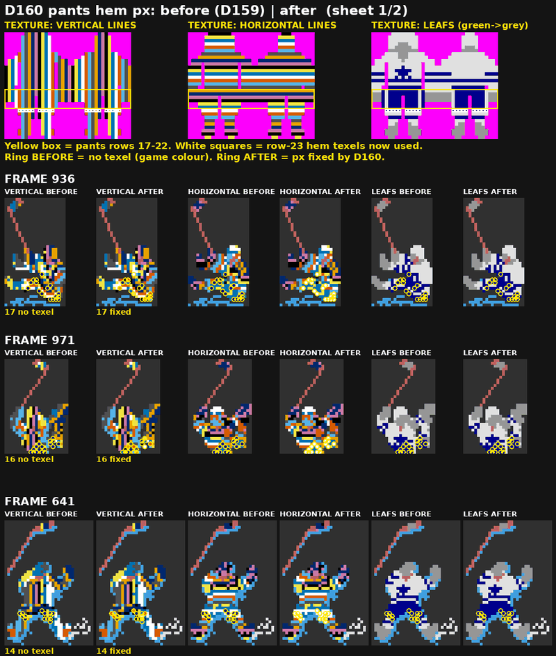

## Stage 10: skeleton (D161/D162)
- **Asked:** a full skater skeleton with limbs, stick and blade (D161). Then a refit with skates on skate pixels, the stick on stick pixels, sanity checks, and hand-fitted joints trusted most (D162).
- **Metrics:** special-pose column breaks 4295 → 4173 (D161) and 5726 → 5659 (D162, new baseline). Skeleton-driven rows (`SKELROWS`) made row breaks worse, so they stay off.
- 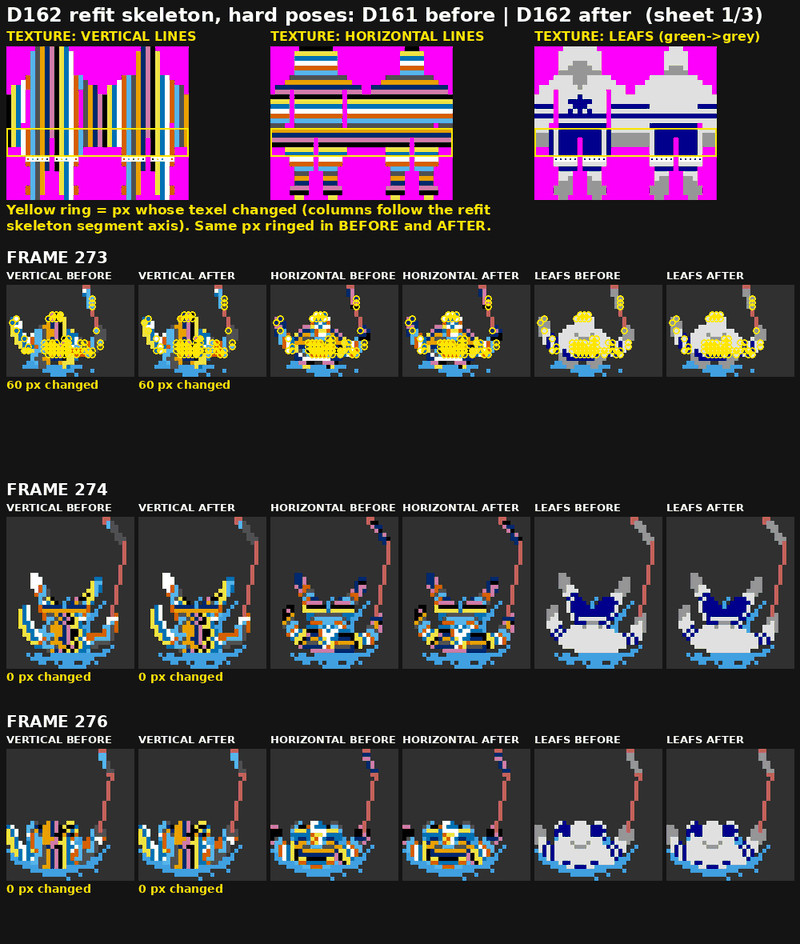

## Stage 11: wrap-up (D163)
- **Asked:** tie things off for a 2-3 week pause, including a full render, an audit of the wrong-band pixels, and `HANDOFF.md`.
- **Found and fixed:** all 1086 "wrong band" pixels were palette 136 face shade mislabelled as stick. The editor now labels them skin, and texture maps are unchanged.
- **Metrics:** Leafs home on 601 mapped skater frames: **0 errors on every textured part**.
- 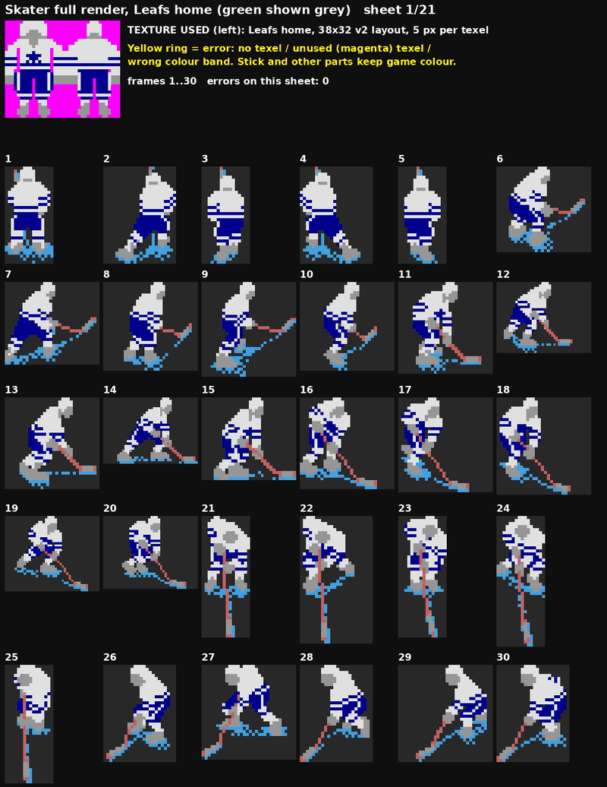

## What is next
Hand-fixing joints on the hard frames (273, 274, 276, 279, 302, 943) and the 5 flagged hand-fitted skeletons. See `HANDOFF.md`.
